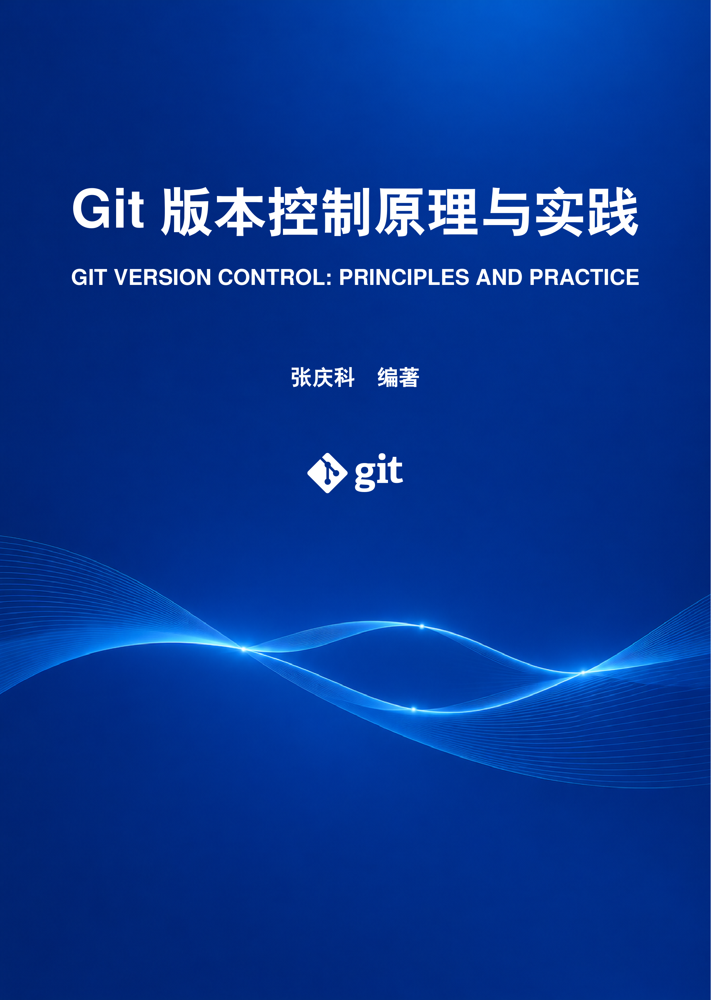
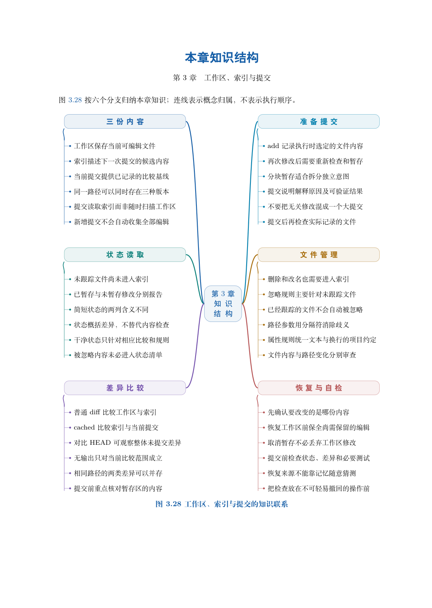
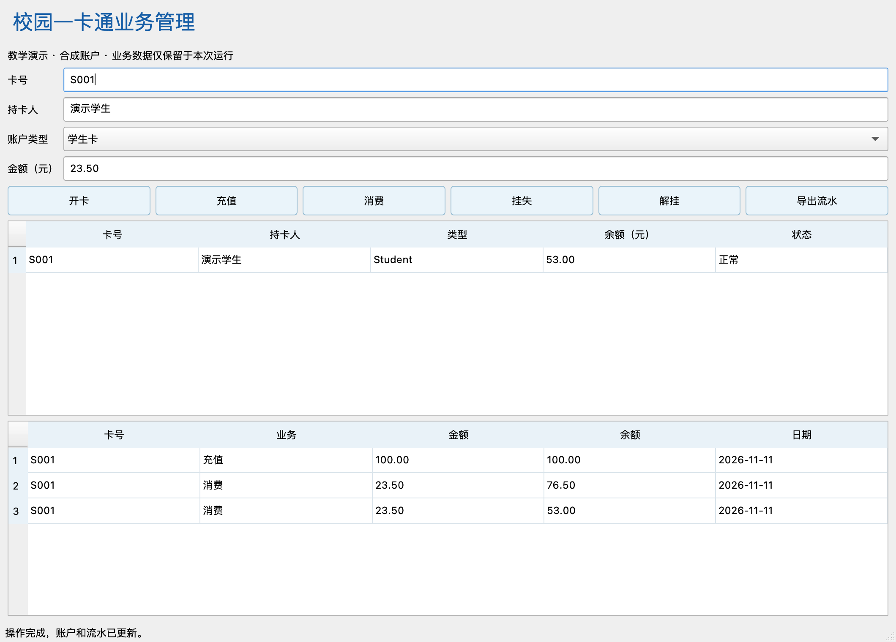

<p align="center"></p>

# GitEasy · Git版本控制原理与实践

[](https://github.com/tsingke/GitEasy/actions/workflows/labs.yml)
[](https://github.com/tsingke/GitEasy/actions/workflows/campus.yml)
[](./LICENSE)

**从第一次提交，到能够解释、验证和交接的工程协作。**

张庆科编著《Git版本控制原理与实践》配套教学项目。全书按基础、核心、进阶、实践四篇组织；本仓库提供17章辅导材料、218道分层习题与完整解析、原创知识结构图、可复现实验、分层练习和综合项目种子。无需平台账号即可完成离线实验。

## 快速开始

需要Git、Bash与Python 3.9及以上版本。第17章另需CMake与C++编译器，Qt图形目标需Qt6开发组件。签名与依赖实验另需OpenSSH和Git subtree，具体范围见[学习说明](./docs/learning-guide.md)。

```bash
git clone https://github.com/tsingke/GitEasy.git
cd GitEasy
python3 tools/run_lab.py --chapter 02
python3 tools/run_lab.py --all --list
```

克隆需要当前仓库的读取权限；没有访问权限的课程读者可使用随书资源包或授权教学副本。

运行器在临时目录建立练习仓库，结束后清理现场，日志另存到证据目录。所有路线只访问本地仓库。手工学习请先阅读本章说明，预测状态再逐块操作。

## 全书导航

| 篇 | 章 | 章节与资源 | 学习重点 |
|---|---:|---|---|
| 基础篇 | 01 | [版本控制与Git基础](./chapters/ch01-版本控制与Git基础/README.md) | 记录与历史边界 |
| 基础篇 | 02 | [环境配置与仓库初始化](./chapters/ch02-环境配置与仓库初始化/README.md) | 目录、配置、首次提交 |
| 基础篇 | 03 | [工作区、索引与提交](./chapters/ch03-工作区、索引与提交/README.md) | 候选内容与文本规则 |
| 基础篇 | 04 | [历史查询与版本溯源](./chapters/ch04-历史查询与版本溯源/README.md) | 查询、范围、二分与批注 |
| 核心篇 | 05 | [分支与HEAD](./chapters/ch05-分支与HEAD/README.md) | 入口、切换与分离状态 |
| 核心篇 | 06 | [合并原理与冲突处理](./chapters/ch06-合并原理与冲突处理/README.md) | 三方、语义与重复冲突 |
| 核心篇 | 07 | [远程仓库与协作](./chapters/ch07-远程仓库与协作/README.md) | 观察记录、映射与交换 |
| 核心篇 | 08 | [变更撤销与版本恢复](./chapters/ch08-变更撤销与版本恢复/README.md) | 保留目标与恢复条件 |
| 进阶篇 | 09 | [对象模型与内容寻址](./chapters/ch09-对象模型与内容寻址/README.md) | 内容寻址、复用与存储 |
| 进阶篇 | 10 | [引用管理与索引机制](./chapters/ch10-引用管理与索引机制/README.md) | 名称、索引与条件更新 |
| 进阶篇 | 11 | [变基、拣选与历史整理](./chapters/ch11-变基、拣选与历史整理/README.md) | 重放、移植与补丁协作 |
| 进阶篇 | 12 | [版本标记、签名与发布](./chapters/ch12-版本标记、签名与发布/README.md) | 版本、归档与信任 |
| 实践篇 | 13 | [团队工作流与代码评审](./chapters/ch13-团队工作流与代码评审/README.md) | 需求、评审与合入策略 |
| 实践篇 | 14 | [仓库规模、依赖与工作树](./chapters/ch14-仓库规模、依赖与工作树/README.md) | 范围、依赖与并行目录 |
| 实践篇 | 15 | [自动化、安全与备份恢复](./chapters/ch15-自动化、安全与备份恢复/README.md) | 检查对象、备份与迁移 |
| 实践篇 | 16 | [GitHub平台与图形化工具](./chapters/ch16-GitHub平台与图形化工具/README.md) | 平台、评审、设置与六种客户端 |
| 实践篇 | 17 | [校园一卡通系统版本管理实训](./chapters/ch17-校园一卡通系统版本管理实训/README.md) | C++11／Qt、协作、维护与发布 |

## 看得见，也能验证



17张纵向复习导图按章节顺序以01–06编号模块呈现，采用无连线的扁平卡片与柔和配色；教材中不纳入图号，提供可编辑源文件。各章另有图解导读、82项状态与工程情境对照，精选30幅生成式插图；关系精度要求较高的图示使用矢量绘制。[导图源文件](./assets/git-book-mindmaps.drawio)与[原理及工程图源](./assets/diagrams/README.md)可继续编辑，图片用于快速浏览。

共38条可运行路线，包括新增的.git内部目录与链接工作树观察。主实验覆盖分支保护、增删冲突、双人交换、恢复矩阵、对象构造、变基、签名、依赖、钩子和综合交付；独立拓展覆盖换行属性、notes、rerere、refspec、打包、补丁和迁移。脚本将预期失败与最终验收区分，保留内容及历史断言。

## 校园一卡通工程实训



[完整项目](./projects/campus-card/README.md)包含开卡、充值、消费、挂失、解挂和流水导出。金额、日期、持卡人、报告和服务按文件与库拆分，CLI与Qt共用服务；核心按C++11构建，Qt6界面目标按C++17构建。五组核心测试与实际按钮检查分别验收。所有账户使用合成数据。

```bash
python3 tools/run_enterprise_lab.py
cmake -S projects/campus-card -B build-campus -DCMAKE_BUILD_TYPE=Release
cmake --build build-campus --parallel 2
ctest --test-dir build-campus --output-on-failure
```

从双人并行开发，到回归修复、维护移植、二分定位、候选验证和独立恢复，19个连续命令块共同形成完整演练。真实Issue、PR、评审与Release按第16、17章人工实践。[校园工程引入PR #1](https://github.com/tsingke/GitEasy/pull/1)可用于观察差异、提交和检查记录；作者自检不等于第三方批准。 [教材资源修订PR #2](https://github.com/tsingke/GitEasy/pull/2)记录此前图解、习题与内部目录实验的同步。[企业工程与版式修订PR #3](https://github.com/tsingke/GitEasy/pull/3)连接本轮规划、模块实现、测试和配套资源。

项目先提供[企业实施方案](./projects/campus-card/docs/enterprise-project-plan.md)、[任务迭代](./projects/campus-card/docs/iterations.md)、[45项技能矩阵](./projects/campus-card/docs/git-skill-matrix.md)与[交付验收](./projects/campus-card/docs/acceptance.md)，再进入连续演练。

原有[文本资料种子](./course/README.md)与[补充综合任务](./supplementary/course-versioning/README.md)继续用于零基础和分层教学。

## 验证与维护

```bash
python3 tools/check_materials.py
python3 tools/run_lab.py --all
```

[实际验证记录](./docs/verification.json)保存已执行环境和路线结果；[CI](https://github.com/tsingke/GitEasy/actions/workflows/labs.yml)提供独立Linux/macOS运行记录。核心项目的跨平台构建与Qt检查由[CampusCard工作流](https://github.com/tsingke/GitEasy/actions/workflows/campus.yml)分别记录。LFS服务、真实平台权限与人工评审不包含在离线通过结论中。

- [教材前言](./docs/preface.md)
- [学习与实验说明](./docs/learning-guide.md)
- [贡献与勘误](./CONTRIBUTING.md)
- [参考资料与原创说明](./docs/references.md)
- [程序代码MIT许可证](./LICENSE)
- [教材使用与版权说明](./BOOK-USE.md)

本项目关注可迁移的理解：明确状态，解释关系，选择合适操作，用证据验证结果。

本教材尚未出版，仅供学习与交流，不得商用；教材文字、原创图表、习题解析及版式的著作权归作者所有。程序代码沿用现有MIT许可，第三方材料按原权利说明使用。勘误请通过本项目Issue提交可复现依据。

## 稿件与客户端资料

[水印设置与稿件流转](./docs/book-watermark.md)说明文字、字号、角度、透明度与位置设置；[客户端功能与许可比较](./docs/client-comparison.md)以两表整理六种工具的系统、费用形式、优势及使用局限。教材目录改用黑色文字，附录仅保留主标题；前言署名与日期保持在第二页，封底只保留标志和底部说明。
