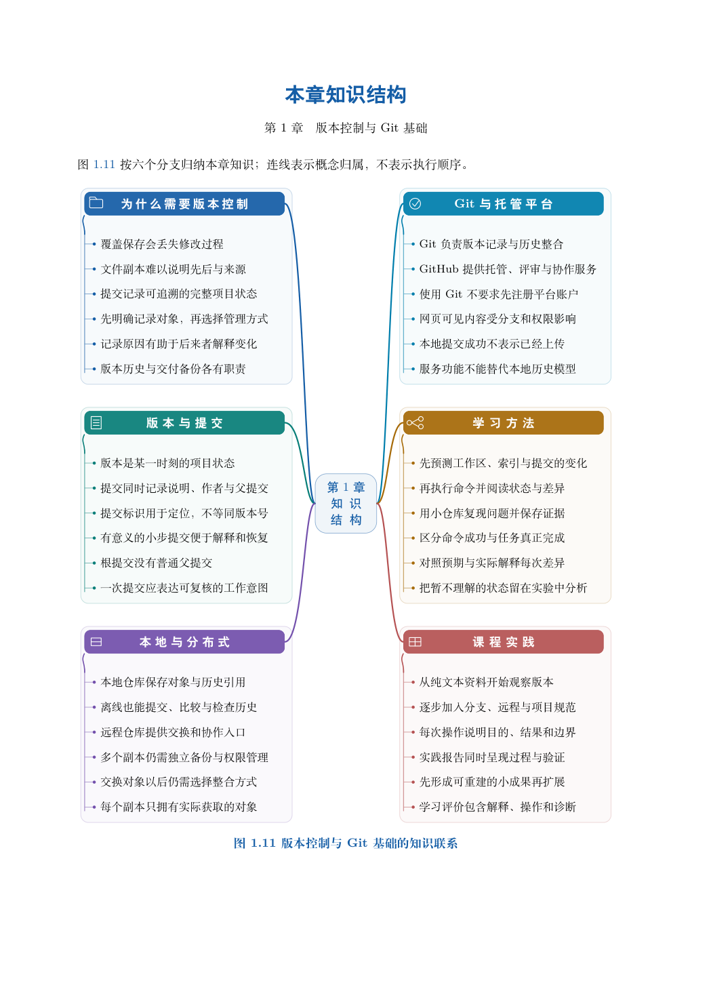

# 第 1 章　版本控制与Git基础

课程资料从一份文件发展为多人的共同成果时，需要持续回答三个问题：当前内容如何形成，哪些修改可以独立说明，不同来源的成果如何整合。版本控制以明确的记录与关系支持这些任务。

本章介绍版本控制的目标、常见组织方式及 Git 的基础模型。暂不要求掌握命令，先区分文件状态、提交对象、历史入口与协作平台，为后续实验建立共同的术语和判断依据。

学习目标：解释版本控制与文件备份的区别；比较本地式、集中式与分布式组织方式；说明快照、对象、引用和索引的基本职责；区分 Git 与 GitHub；能够从内容和历史两个维度描述一次修改。

## 阅读顺序

先阅读教材本章，再研读以下辅导材料；实验运行前预测文件、索引与引用的变化。

- [ch01.md](./ch01.md)

## 本章知识入口

- 版本控制解决什么问题
- 版本控制的几种组织方式
- Git 的形成背景与设计问题
- 从快照理解项目状态
- 从对象和引用理解历史
- 从索引理解提交的选择
- Git、远程仓库与托管平台
- 学习过程中的证据与责任

## 范例代码

本章侧重概念研读，请结合第2章验证记录过程。

从 GitEasy 根目录运行：

```bash
本章侧重概念研读，无自动运行实验。
```

运行器在临时目录建立教学仓库，不修改当前项目，不连接 GitHub。`textbook-route.sh` 来自书内主实验及其验收断言；`extension-*.sh` 对应独立拓展实验。预期拒绝写在条件分支中，出现拒绝提示不一定表示实验失败。完整输出和最终退出状态由运行器保存。不要把脚本片段直接粘贴到正在工作的仓库中。

## 章末知识结构



## 练习与解析

[练习任务](./exercises.md)要求提交自己的结果与解释；辅导材料中的分析用于核对推理，不替代独立完成。

[返回全书目录](../../README.md)

## 图解与练习升级

本章提供11道分层习题，最后一题为工程综合任务；[图解导读](./visual-guide.md)、[习题](./exercises.md)与[完整题意和解析](./answers.md)相互对应。
