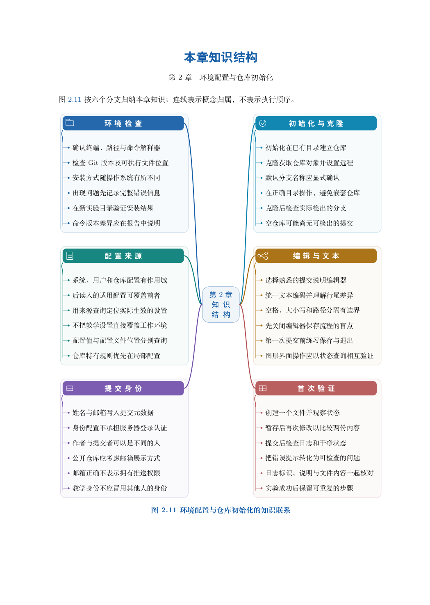

# 第 2 章　环境配置与仓库初始化

假设你准备整理一份课程学习笔记。今天写下两段内容，明天修正其中一句，周末再请同学补充。你希望每次重要修改都有记录，也希望能够确认某次修改究竟保存了什么。本章从这个需求出发，完成安装、配置、建仓和两次提交。实验不需要 GitHub 账号，也不需要连接远程仓库。

学习目标：能够检查 Git 是否可用；区分提交身份与平台登录；在指定目录初始化仓库；完成“编辑、暂存、提交、检查”的循环；判断文件是否已经进入历史；识别初次操作中的常见失败原因。

## 阅读顺序

先阅读教材本章，再研读以下辅导材料；实验运行前预测文件、索引与引用的变化。

- [ch02-interface.md](./ch02-interface.md)
- [ch02.md](./ch02.md)

## 本章知识入口

- 安装之前先检查
- 创建一个独立的学习仓库
- 从一个文件走到第一次提交
- 第二次修改：历史开始形成
- 把无关文件排除在提交之外
- 另一种起点：克隆已有仓库
- 初次操作失败时，先检查什么

## 范例代码

- [extension-02.sh](./examples/extension-02.sh)

从 GitEasy 根目录运行：

```bash
python3 tools/run_lab.py --chapter 02
```

运行器在临时目录建立教学仓库，不修改当前项目，不连接 GitHub。`textbook-route.sh` 来自书内主实验及其验收断言；`extension-*.sh` 对应独立拓展实验。预期拒绝写在条件分支中，出现拒绝提示不一定表示实验失败。完整输出和最终退出状态由运行器保存。不要把脚本片段直接粘贴到正在工作的仓库中。

## 章末知识结构



## 练习与解析

[练习任务](./exercises.md)要求提交自己的结果与解释；辅导材料中的分析用于核对推理，不替代独立完成。

[返回全书目录](../../README.md)

## 图解与练习升级

本章提供11道分层习题，最后一题为工程综合任务；[图解导读](./visual-guide.md)、[习题](./exercises.md)与[完整题意和解析](./answers.md)相互对应。
