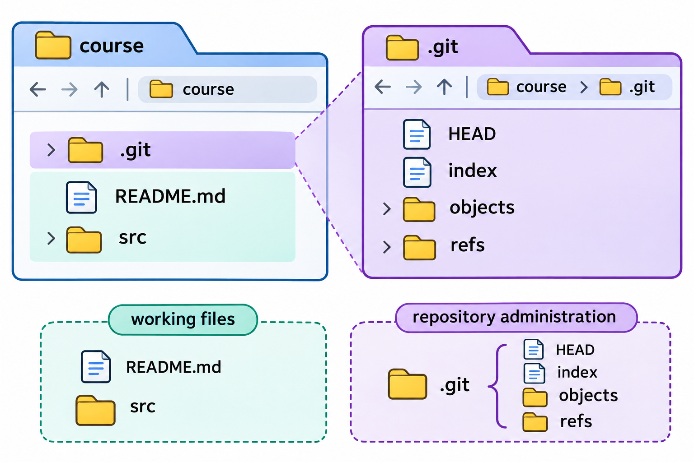
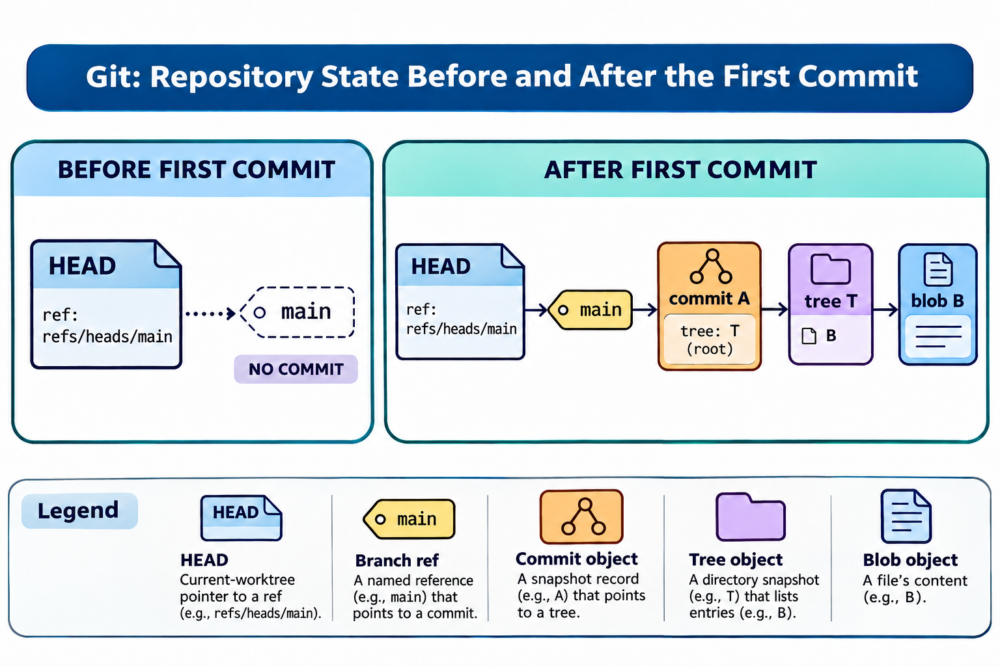

# 环境配置与仓库初始化：图解与复习

这些原创图解配合教材正文使用。提交字母和短标识均为示意；箭头含义见各图说明。

项目文件与Git管理信息的分工。

未诞生分支与首次提交后的对象连接。

## 状态与工程情境复习

### 一次新提交前后的三份内容

在工作区与索引已经一致的前提下，普通提交把所选快照记录到新的提交中。图示比较记录前后的内容，提醒读者区分文件没有继续改变与历史新增了一条记录。

| 观察位置 | 提交之前 | 普通提交之后 |
|---|---|---|
| HEAD中的内容 | 旧版 | 新版 |
| 索引候选 | 新版 | 新版 |
| 工作文件 | 新版 | 新版 |

[可编辑情境图结构源文件](../../assets/git-scenarios.drawio)
