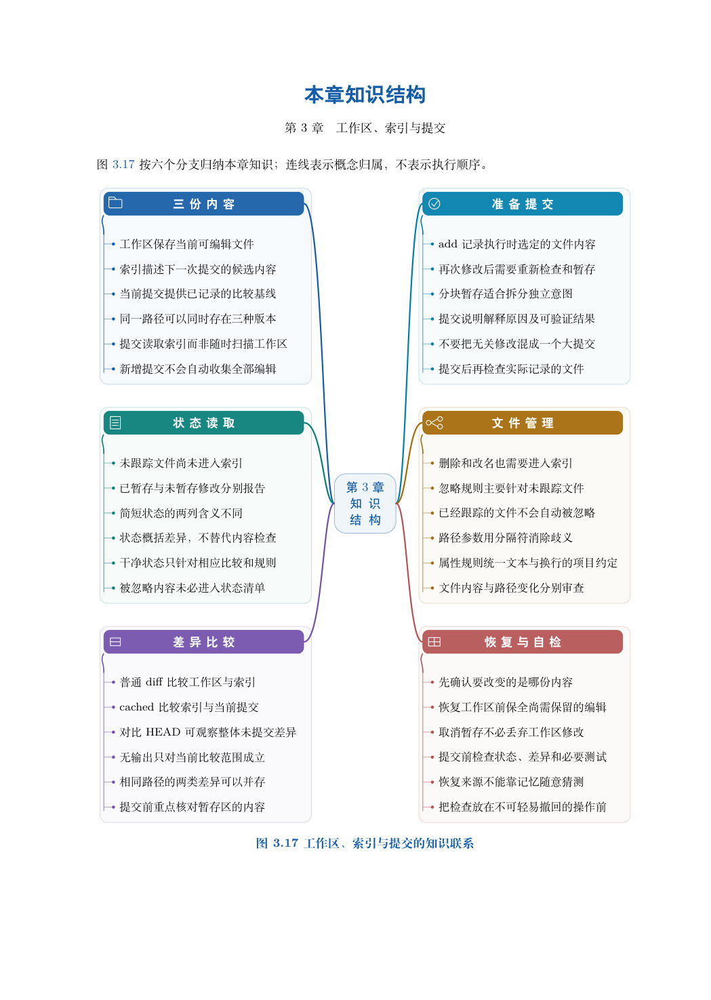

# 第 3 章　工作区、索引与提交

上章中，文件经过 add 后才成为待提交内容。由此会产生两个问题：既然 Git 知道文件已经修改，为什么还需要暂存？同一个文件为什么可能同时显示“已暂存”和“未暂存”？本章通过逐行可检查的实验回答这两个问题。

学习目标：能够分别检查工作区、索引和 HEAD 中的文件内容；预测 add 与 commit 的结果；区分三种 diff 的比较对象；读懂 status 的两列状态；把混在同一文件中的两项修改组织为两次提交；在保留工作内容的前提下撤销暂存。

## 阅读顺序

先阅读教材本章，再研读以下辅导材料；实验运行前预测文件、索引与引用的变化。

- [ch03-attributes.md](./ch03-attributes.md)
- [ch03-ignore.md](./ch03-ignore.md)
- [ch03.md](./ch03.md)

## 本章知识入口

- 为什么需要一份候选内容
- 主实验：让三份内容依次分开
- 三种 diff 分别比较什么
- 读懂 status 的两列状态
- 部分暂存：一次只提交一个意图
- 取消暂存与恢复工作文件
- 忽略、删除与停止跟踪
- 索引到底保存了什么

## 范例代码

- [extension-03-attributes.sh](./examples/extension-03-attributes.sh)
- [extension-03-ignore.sh](./examples/extension-03-ignore.sh)
- [extension-03.sh](./examples/extension-03.sh)

从 GitEasy 根目录运行：

```bash
python3 tools/run_lab.py --chapter 03
```

运行器在临时目录建立教学仓库，不修改当前项目，不连接 GitHub。`textbook-route.sh` 来自书内主实验及其验收断言；`extension-*.sh` 对应独立拓展实验。预期拒绝写在条件分支中，出现拒绝提示不一定表示实验失败。完整输出和最终退出状态由运行器保存。不要把脚本片段直接粘贴到正在工作的仓库中。

## 章末知识结构



## 练习与解析

[练习任务](./exercises.md)要求提交自己的结果与解释；辅导材料中的分析用于核对推理，不替代独立完成。

[返回全书目录](../../README.md)

## 图解与练习升级

本章提供11道分层习题，最后一题为工程综合任务；[图解导读](./visual-guide.md)、[习题](./exercises.md)与[完整题意和解析](./answers.md)相互对应。
