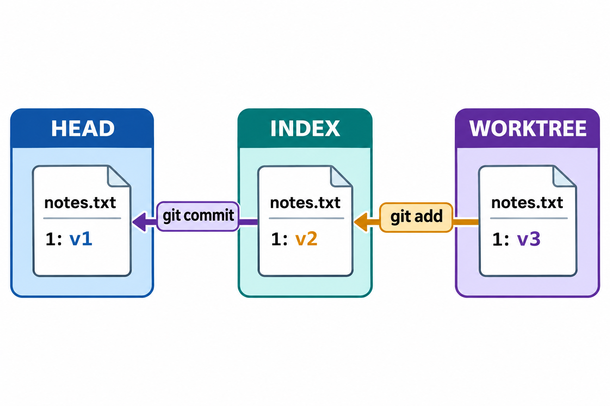
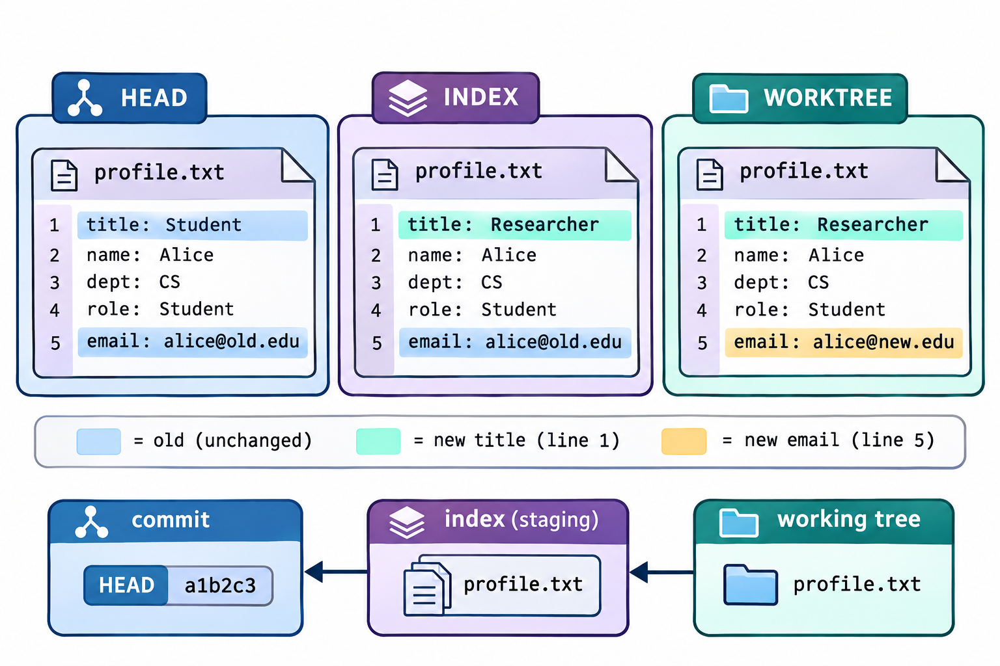

# 工作区、索引与提交：图解与复习

这些原创图解配合教材正文使用。提交字母和短标识均为示意；箭头含义见各图说明。

三份内容与各命令的写入目标。

同一路径的部分暂存与候选内容。

## 状态与工程情境复习

### XY两列分别描述两组比较

读取短格式状态时，先确定每列的比较起点，再解释字母。两列可以同时出现修改，因为同一路径在索引和工作文件中可以保存不同内容。

| 状态列 | 比较对象 | 回答的问题 |
|---|---|---|
| X列 | HEAD与索引 | 候选相对上次提交怎样变化 |
| Y列 | 索引与工作文件 | 候选之后还有哪些编辑 |

### 忽略规则与跟踪状态分开判断

忽略规则主要控制未跟踪路径的常规发现行为。对已经跟踪的路径，停止跟踪需要另行调整索引；新增规则不会把旧提交中的内容清除。

| 路径状态 | 新增忽略规则 | 已有历史 |
|---|---|---|
| 未跟踪 | 影响常规发现与选择 | 尚无该路径的提交记录 |
| 已跟踪 | 不自动取消跟踪 | 旧快照继续保留 |

### 删除路径与仅停止跟踪

同样从下一次快照中移除一个路径，可以对应不同的工作现场结果。操作前应确认是否还要在磁盘保留该文件，完成后分别检查候选和工作目录。

| 操作范围 | 索引中的路径 | 工作目录路径 |
|---|---|---|
| 删除并记录删除 | 移除 | 移除 |
| 仅停止跟踪 | 移除 | 保留 |

### 索引条目的四类关键字段

索引保存构造候选树所需的信息，不能把它理解为只有文件名的一张清单。模式、对象标识和阶段共同限定条目的含义，查询时应结合各字段阅读。

| 字段 | 含义 |
|---|---|
| 路径 | 快照中使用的相对名称 |
| 模式 | 普通文件、可执行文件等类型信息 |
| 对象标识 | 候选内容所对应的对象 |
| 阶段 | 普通条目为0；冲突时按来源区分 |

### 取消暂存与恢复文件的目标

恢复命令需要明确来源和目标。两类操作可能针对同一个路径，却改变不同层次；应通过候选差异与未暂存差异分别验证，避免把一个空输出当作全部内容已恢复。

| 任务 | 写入目标 | 保留观察 |
|---|---|---|
| 取消暂存 | 索引 | 工作文件仍可保留编辑 |
| 恢复工作文件 | 工作目录 | 索引不一定随之改变 |

### 三种内容比较的起点与终点

差异中的增删只在选定两端之间成立。先读比较范围，再解释补丁，能够说明为何同一路径在两条diff命令下出现不同结果。

| 查询意图 | 起点 | 终点 |
|---|---|---|
| 未暂存差异 | 索引 | 工作文件 |
| 已暂存差异 | HEAD | 索引 |
| 相对上次提交 | HEAD | 工作文件 |

### 重复暂存更新的是候选内容

第二次编辑不会自动更新索引。只有再次选择相应内容，候选才与第三版工作文件一致；这个过程也解释了为何提交之前必须重新核对候选。

| 时刻 | 索引 | 工作文件 |
|---|---|---|
| 首次暂存后 | 第二版 | 第二版 |
| 继续编辑后 | 第二版 | 第三版 |
| 再次暂存后 | 第三版 | 第三版 |

### 属性规则与文件字节分别观察

属性描述路径内容的处理约定，文件字节描述当前实际输入。改变规则后需要审查规范化结果，不能假定已有索引和历史已自动整体改写。

| 观察点 | 需要确认的内容 |
|---|---|
| 路径规则 | 哪些属性实际作用于该路径 |
| 工作文件 | 当前编码及行尾字节 |
| 索引内容 | 规范化后选入的候选 |
| 历史比较 | 规范化与功能变化是否分开审阅 |

[可编辑情境图结构源文件](../../assets/git-scenarios.drawio)
