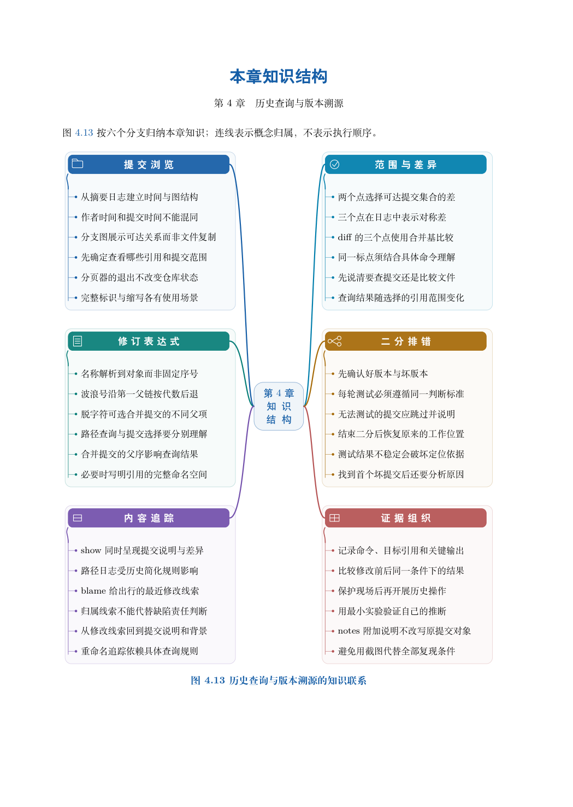

# 第 4 章　历史查询与版本溯源

资料保存下来之后，新的问题随之出现：一条要求何时加入？某行文字为什么改变？哪个版本开始出现错误？本章从这些具体问题出发，建立“提出问题、选择范围、阅读差异、验证判断”的历史查询方法。

学习目标：能组合 log 的范围、筛选与输出；能区分提交集合与两个端点的文件比较；能用修订记号和 show 读取历史；能结合 blame、差异和背景解释一次变更；能准备稳定判定并通过 bisect 定位首次出现问题的提交。

## 阅读顺序

先阅读教材本章，再研读以下辅导材料；实验运行前预测文件、索引与引用的变化。

- [ch04-notes.md](./ch04-notes.md)
- [ch04.md](./ch04.md)

## 本章知识入口

- 先把问题改写成可查询的条件
- 读懂 log：入口、筛选与输出
- 修订记号与范围的两种语义
- show、文件历史与逐行线索
- 完整实验：从资料变更到故障提交
- bisect：把可重复判断放入历史搜索
- 有分叉时怎样检索
- 常见误判与报告写法

## 范例代码

- [extension-04-notes.sh](./examples/extension-04-notes.sh)
- [extension-04.sh](./examples/extension-04.sh)
- [textbook-route.sh](./examples/textbook-route.sh)

从 GitEasy 根目录运行：

```bash
python3 tools/run_lab.py --chapter 04
```

运行器在临时目录建立教学仓库，不修改当前项目，不连接 GitHub。`textbook-route.sh` 来自书内主实验及其验收断言；`extension-*.sh` 对应独立拓展实验。预期拒绝写在条件分支中，出现拒绝提示不一定表示实验失败。完整输出和最终退出状态由运行器保存。不要把脚本片段直接粘贴到正在工作的仓库中。

## 章末知识结构



## 练习与解析

[练习任务](./exercises.md)要求提交自己的结果与解释；辅导材料中的分析用于核对推理，不替代独立完成。

[返回全书目录](../../README.md)

## 图解与练习升级

本章提供13道分层习题，最后一题为工程综合任务；[图解导读](./visual-guide.md)、[习题](./exercises.md)与[完整题意和解析](./answers.md)相互对应。
