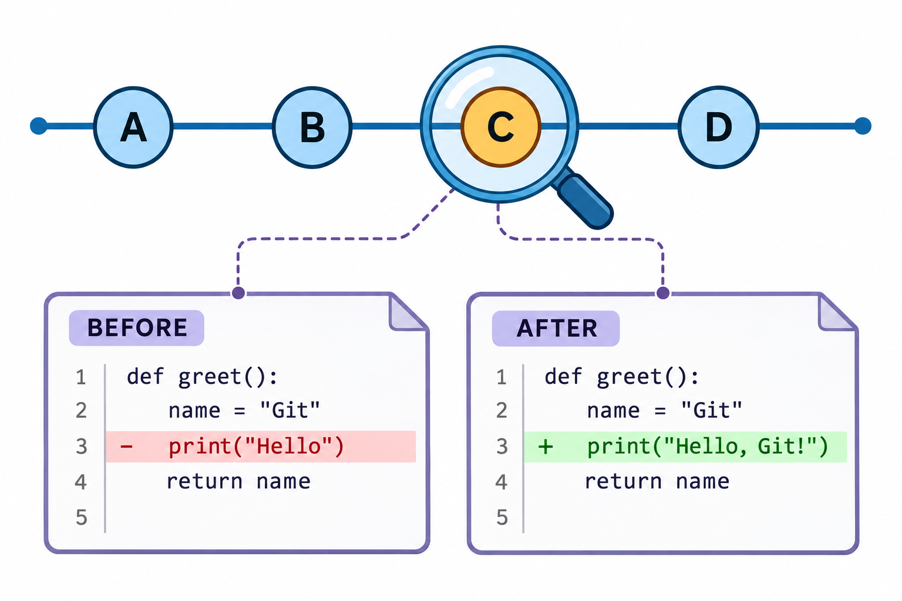
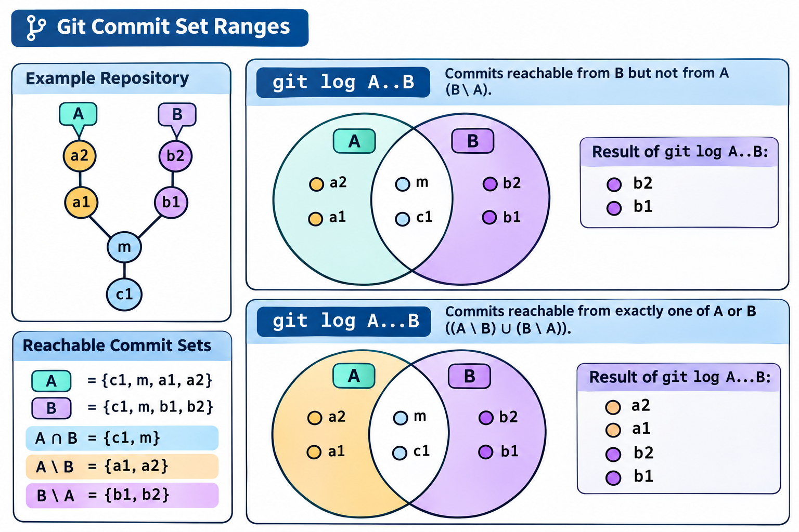

# 历史查询与版本溯源：图解与复习

这些原创图解配合教材正文使用。提交字母和短标识均为示意；箭头含义见各图说明。

从调查问题选择历史与内容查询。

git log中双点号与三点号范围的集合含义。

## 状态与工程情境复习

### 二分定位需要稳定的判定

二分查找依赖同一个可重复判定。编译器缺失、测试环境不完整和业务行为不符是不同结果，应在自动脚本中分开处理，防止环境问题污染定位结论。

| 输入或结果 | 含义 | 后续处理 |
|---|---|---|
| 已知好版本 | 满足指定判定 | 作为一侧边界 |
| 已知坏版本 | 不满足同一判定 | 作为另一侧边界 |
| 无法运行 | 不能据此判好坏 | 按协议跳过或修复环境 |

### 逐行线索与变更原因的调查

逐行批注为调查提供入口，提交说明与讨论补足变化背景。多项资料应共同支持结论，不能把最后修改者直接等同于现实责任人。

| 查询结果 | 进一步阅读 | 可以形成的结论 |
|---|---|---|
| 某行关联提交 | 完整补丁与说明 | 该次变化的上下文 |
| 路径相关历史 | 改名与筛选条件 | 查询范围内的演进 |
| 关联讨论 | 需求与评审记录 | 变化的理由和约束 |

### 查询集合与文件比较分别选择

有分叉时，提交集合和树差异可能回答完全不同的问题。明确本次调查究竟寻找哪些记录，还是比较哪两份内容，能够减少对双点号、三点号的误用。

| 任务 | 需要确定的对象 |
|---|---|
| 选择提交 | 入口、排除集合和祖先关系 |
| 比较文件 | 两份树或指定的比较基线 |
| 追查原因 | 候选提交、补丁与上下文 |

### notes在独立入口中关联说明

notes可以为已有对象补充说明，不必原地改写提交正文。共享时应确认相应引用是否传送，避免把本地可见的注释误认为所有副本都已取得。

| 内容 | 保存位置与影响 |
|---|---|
| 原提交 | 正文与标识保持不变 |
| 附加说明 | 由notes相关引用组织 |
| 共享安排 | 需要单独约定传送范围 |

[可编辑情境图结构源文件](../../assets/git-scenarios.drawio)
