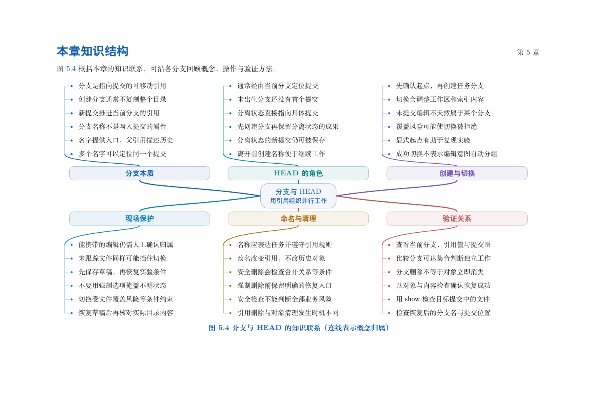

# 第 5 章　分支与HEAD

一份课程资料已经可以使用，同时有人要增加实验，有人要修订安排。我们希望分别推进、随时比较，再有选择地整合。分支为不同任务提供历史入口，HEAD 标记当前工作的位置。本章把“名字指向哪里”与“目录里现在有什么”分开解释。

学习目标：能解释分支、HEAD 与提交的关系；能预测创建、切换、提交、重命名和删除的影响；能判断未提交工作何时可以随切换保留、何时会阻止切换；能保存在分离状态产生的成果；能用内容和可达关系核对任务是否已经整合。

## 阅读顺序

先阅读教材本章，再研读以下辅导材料；实验运行前预测文件、索引与引用的变化。

- [ch05.md](./ch05.md)

## 本章知识入口

- 为什么一个项目需要多条工作路线
- 名称、提交与可达历史
- HEAD 如何表示当前位置
- 完整实验一：从空仓库到两条路线
- 切换分支究竟检查什么
- 创建与切换命令的边界
- 分离观察与保存实验成果
- 命名、重命名与查询
- 清理名称前，先区分内容与祖先关系
- 任务复盘：从症状回到模型

## 范例代码

- [extension-05.sh](./examples/extension-05.sh)
- [textbook-route.sh](./examples/textbook-route.sh)

从 GitEasy 根目录运行：

```bash
python3 tools/run_lab.py --chapter 05
```

运行器在临时目录建立教学仓库，不修改当前项目，不连接 GitHub。`textbook-route.sh` 来自书内主实验及其验收断言；`extension-*.sh` 对应独立拓展实验。预期拒绝写在条件分支中，出现拒绝提示不一定表示实验失败。完整输出和最终退出状态由运行器保存。不要把脚本片段直接粘贴到正在工作的仓库中。

## 章末知识结构



## 练习与解析

[练习任务](./exercises.md)要求提交自己的结果与解释；辅导材料中的分析用于核对推理，不替代独立完成。

[返回全书目录](../../README.md)
