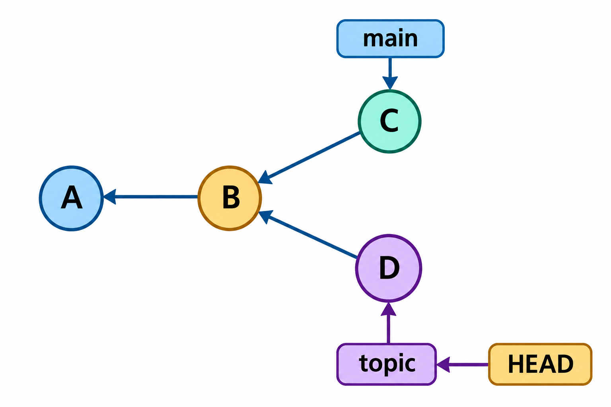
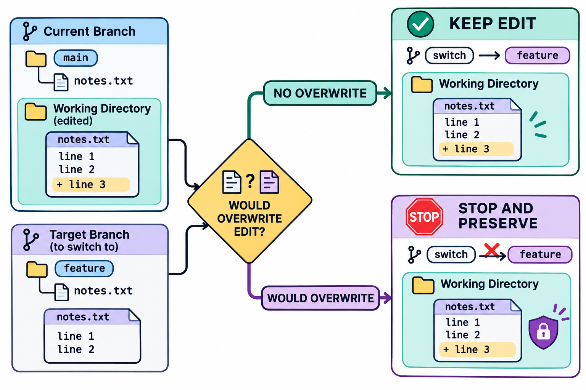

# 分支与HEAD：图解与复习

这些原创图解配合教材正文使用。提交字母和短标识均为示意；箭头含义见各图说明。

共享祖先上的分支入口与HEAD。

分支切换时的覆盖检查与现场保护。

## 状态与工程情境复习

### 分离HEAD上的实验需要建立入口

分离状态下建立的提交仍是有效对象。离开试验现场前，应为需要保留的结果建立明确入口，再检查新名称解析到的内容。

| 阶段 | HEAD所指 | 保存方式 |
|---|---|---|
| 检出一个提交 | 直接指向提交 | 可以观察与继续试验 |
| 形成新提交 | 直接指向新提交 | 尚需安排长期入口 |
| 建立主题分支 | 新分支保存该提交 | 以后可按名称返回 |

[可编辑情境图结构源文件](../../assets/git-scenarios.drawio)
