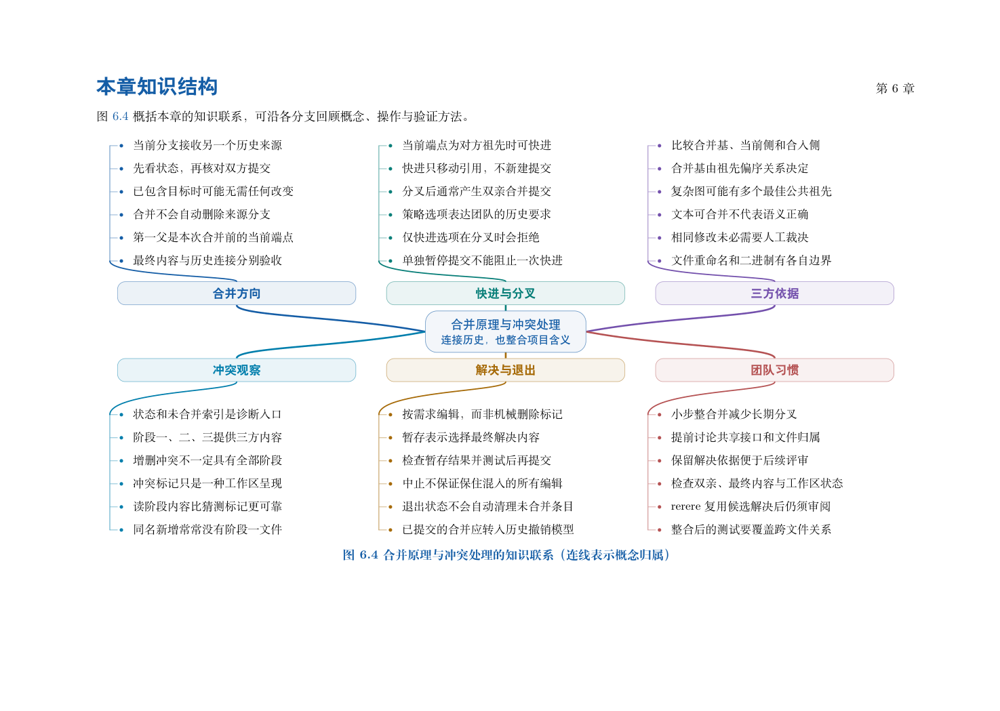

# 第 6 章　合并原理与冲突处理

分支解决“怎样分别推进”，合并解决“怎样把工作重新连接起来”。连接历史并不等于把两个目录简单叠放：同一个文件可能被两边修改，也可能一边删除、一边继续维护；即使文本可以自动拼接，组合后的程序仍可能违背原来的需求。

本章先从提交的祖先关系判断合并形态，再通过课程安排、文件增删和计价程序三个场景解释冲突。读者应能回答：当前分支将发生什么变化，Git 根据哪些版本整合内容，哪些决定必须由人作出，以及怎样留下可以检查的整合证据。

学习目标：辨认快进、分叉和已包含三种情形；解释合并基与多阶段索引；完成冲突观察、内容决策、暂存、验证和提交；区分中止合并与退出合并状态；识别自动合并中的语义问题。

## 阅读顺序

先阅读教材本章，再研读以下辅导材料；实验运行前预测文件、索引与引用的变化。

- [ch06-rerere.md](./ch06-rerere.md)
- [ch06.md](./ch06.md)

## 本章知识入口

- 先明确合并的方向与条件
- 实验一：比较三种合并选项
- 三方合并为什么需要公共基线
- 实验二：完整观察和解决文本冲突
- 实验三：文件删除与新增的冲突
- 中止、退出与已经完成的合并
- 实验四：自动合并通过，计算却错了
- 建立可以复核的冲突处理流程

## 范例代码

- [extension-06-rerere.sh](./examples/extension-06-rerere.sh)
- [extension-06.sh](./examples/extension-06.sh)
- [textbook-route.sh](./examples/textbook-route.sh)

从 GitEasy 根目录运行：

```bash
python3 tools/run_lab.py --chapter 06
```

运行器在临时目录建立教学仓库，不修改当前项目，不连接 GitHub。`textbook-route.sh` 来自书内主实验及其验收断言；`extension-*.sh` 对应独立拓展实验。预期拒绝写在条件分支中，出现拒绝提示不一定表示实验失败。完整输出和最终退出状态由运行器保存。不要把脚本片段直接粘贴到正在工作的仓库中。

## 章末知识结构



## 练习与解析

[练习任务](./exercises.md)要求提交自己的结果与解释；辅导材料中的分析用于核对推理，不替代独立完成。

[返回全书目录](../../README.md)
