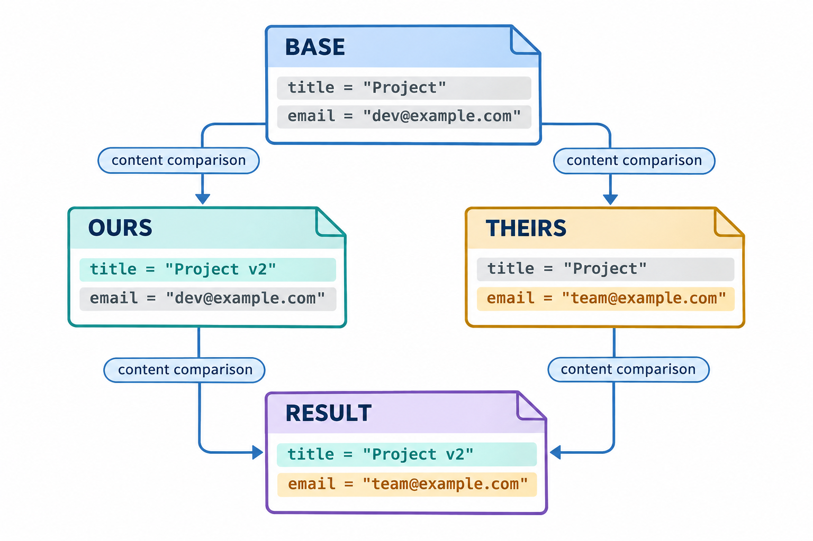

# 合并原理与冲突处理：图解与复习

这些原创图解配合教材正文使用。提交字母和短标识均为示意；箭头含义见各图说明。

公共基线与两侧独立修改的三方比较。

**不同冲突类型中的并列索引阶段**：教材采用可编辑矢量图展示，结构源文件见[图解修订源图](../../assets/git-visual-refinements.drawio)。

## 状态与工程情境复习

### 三种合并选项约束不同

选项约束的是允许采用的历史整合方式。拒绝一次非快进合并，并不表示来源内容必然有文本冲突；需要先区分祖先关系与文件比较。

| 选项或方式 | 允许快进时 | 已经分叉时 |
|---|---|---|
| 通常的合并 | 可以快进 | 按内容与历史整合 |
| 要求合并提交 | 形成显式连接 | 形成合并提交或暂停 |
| 仅允许快进 | 更新入口 | 拒绝分叉整合 |

### 当前分支决定整合的接收方向

交换命令参数和切换当前分支，可能形成不同的接收位置与第一父项。执行前应把当前分支、来源入口和公共基线分别写出，随后再解释结果。

| 位置 | 职责 |
|---|---|
| 当前分支 | 接收来源并保存整合结果 |
| 来源入口 | 指出需要接入的历史 |
| 公共基线 | 帮助识别两侧各自的变化 |

### 解决冲突分为内容与状态两步

编辑器中移除冲突标记后，Git还需要明确的解决记录。最终提交之前，应同时检查文件语义、候选差异和未合并条目，避免只完成其中一项。

| 处理阶段 | 工作文件 | 索引 |
|---|---|---|
| 出现冲突 | 保留待判断内容或标记 | 记录不同来源 |
| 编辑完成 | 形成预期结果 | 仍需记录解决 |
| 确认解决 | 保留结果 | 普通阶段条目进入候选 |

### 中止合并与忘记合并状态

中止和退出状态有不同目的。判断命令结果时，应查询合并管理信息与实际文件，不能根据提示消失推断原有现场已经恢复。

| 动作 | 整合状态 | 工作现场 |
|---|---|---|
| 中止 | 结束当前合并过程 | 尝试返回合并前状态 |
| 退出状态 | 不再保留当前合并管理状态 | 冲突内容和条目可能仍在 |
| 已经提交 | 不属于暂停中的过程 | 另按恢复策略处理 |

### 文本整合与业务验证分层进行

两条分支分别通过检查后，组合结果仍可能违反共同约定。文本整合、构建和业务测试应连续执行，并说明每一层已经覆盖与尚未覆盖的条件。

| 检查层次 | 检查内容 | 通过的边界 |
|---|---|---|
| 语法与文本 | 冲突标记和可整合内容 | 不能证明接口约定一致 |
| 构建与接口 | 类型、符号和调用关系 | 不能覆盖未测试行为 |
| 业务规则 | 输入、输出与不变量 | 结论限于已验证条件 |

### 冲突解决材料应支持复查

冲突处理包含工程决定。保留来源、修改理由和验证结果，能使同伴理解解决方案，并为以后出现相似冲突提供可核对的依据。

| 材料 | 需要说明的内容 |
|---|---|
| 来源 | 当前、合入侧与基线版本 |
| 决定 | 采用、修改或删除内容的理由 |
| 结果 | 最终候选与实际文件 |
| 证据 | 检查命令、测试及结论 |

### 修改与删除冲突的两类业务决定

修改／删除冲突不能仅凭哪一侧文件较新作出决定。应先明确删除的目的和修改的依赖，再选择最终快照，并检查仍然引用该路径的内容。

| 决定 | 文件结果 | 需要验证的依赖 |
|---|---|---|
| 保留并调整 | 继续存在 | 调用方与新增规则 |
| 接受删除 | 不再存在 | 引用路径与替代实现 |

### 公共基线用于辨认变化

三方比较关心两侧相对公共基线分别发生了什么。没有文本冲突时也应阅读最终结果，尤其要检查两项独立修改组合后的接口与业务假设。

| 来源 | 相对基线的情况 | 整合时的意义 |
|---|---|---|
| 当前侧 | 保留或修改 | 辨认当前任务的变化 |
| 合入侧 | 保留或修改 | 辨认来源任务的变化 |
| 两侧结果 | 可能文本兼容 | 仍需判断共同语义 |

[可编辑情境图结构源文件](../../assets/git-scenarios.drawio)
