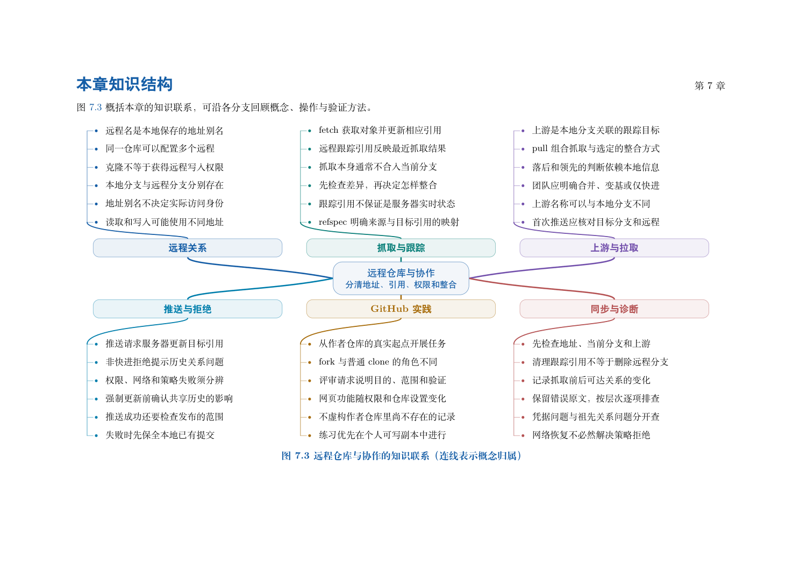

# 第 7 章　远程仓库与协作

两个人各自在本地提交，都可以得到完整而清晰的工作记录。协作的新问题是：怎样交换记录，怎样发现对方的新工作，怎样在不覆盖彼此成果的前提下更新共享分支。

本章先用同一台机器上的三个目录模拟一个共享中心和两位参与者，再把相同的数据关系映射到 GitHub。这样可以把历史整合与网络、身份、权限分别理解，不会把每次失败都归因于账号或网络。

学习目标：区分本地分支、远程跟踪引用和服务器分支；解释抓取、整合与推送的不同作用；读取上游配置和领先／落后信息；诊断非快进拒绝；完成异名分支推送与跟踪清理实验；设计基于 GitEasy 的个人副本协作流程。

## 阅读顺序

先阅读教材本章，再研读以下辅导材料；实验运行前预测文件、索引与引用的变化。

- [ch07-refspec.md](./ch07-refspec.md)
- [ch07.md](./ch07.md)

## 本章知识入口

- 远程表示通信关系，不表示唯一主副本
- 三个分支位置与两种方向
- 实验一：建立真实的双人协作循环
- 上游配置与默认推送不是同一回事
- 实验二：读取配置并推送到异名分支
- 删除远程分支与清理本地记录
- 把同一个模型迁移到 GitHub
- 按层次排查协作失败

## 范例代码

- [extension-07-refspec.sh](./examples/extension-07-refspec.sh)
- [extension-07.sh](./examples/extension-07.sh)
- [textbook-route.sh](./examples/textbook-route.sh)

从 GitEasy 根目录运行：

```bash
python3 tools/run_lab.py --chapter 07
```

运行器在临时目录建立教学仓库，不修改当前项目，不连接 GitHub。`textbook-route.sh` 来自书内主实验及其验收断言；`extension-*.sh` 对应独立拓展实验。预期拒绝写在条件分支中，出现拒绝提示不一定表示实验失败。完整输出和最终退出状态由运行器保存。不要把脚本片段直接粘贴到正在工作的仓库中。

## 章末知识结构



## 练习与解析

[练习任务](./exercises.md)要求提交自己的结果与解释；辅导材料中的分析用于核对推理，不替代独立完成。

[返回全书目录](../../README.md)
