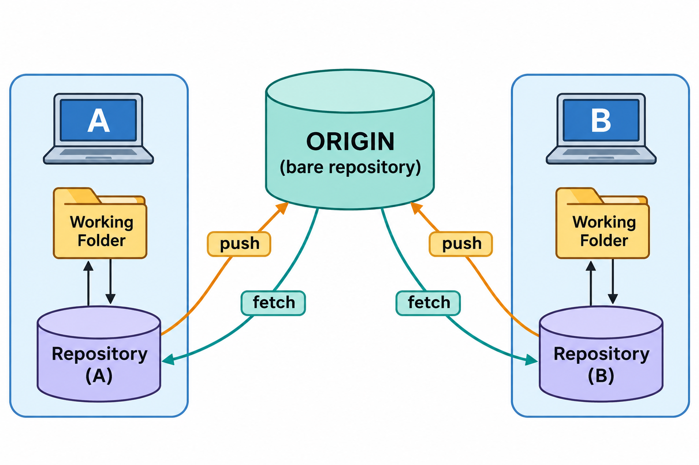

# 远程仓库与协作：图解与复习

这些原创图解配合教材正文使用。提交字母和短标识均为示意；箭头含义见各图说明。

两个仓库中的交换方向与引用位置。

**抓取前后服务器分支与两类本地引用**：教材采用可编辑矢量图展示，结构源文件见[图解修订源图](../../assets/git-visual-refinements.drawio)。

## 状态与工程情境复习

### 抓取映射与推送映射分开阅读

refspec两侧的意义依赖通信方向。先确定是谁向谁取得或发送信息，再解释冒号两侧的引用，能够避免把抓取配置误认为服务器写入授权。

| 方向 | 来源 | 目标 |
|---|---|---|
| 抓取 | 另一仓库的引用 | 本地观察记录 |
| 推送 | 本地选定引用 | 另一仓库的目标引用 |

### 删除三个位置的名称分别进行

服务器名称、本地观察记录和工作分支可能在不同时间更新。清理时逐项确认目标与保留需要，不应把一次删除理解为三个位置同时消失。

| 位置 | 可能的操作 | 不会自动完成 |
|---|---|---|
| 服务器分支 | 向服务器请求删除 | 删除本地工作分支 |
| 本地观察记录 | 抓取时清理失效记录 | 删除本地工作分支 |
| 本地工作分支 | 按合入条件整理入口 | 删除服务器分支 |

### 协作失败沿通信与历史分层排查

同一个推送失败可能来自不同层次。读取服务端的具体原因后，再选择处理措施；重建本地历史不能解决错误地址或身份授权问题。

| 层次 | 典型判断 |
|---|---|
| 地址与连通 | 是否联系到预期服务 |
| 身份与授权 | 该身份是否可执行目标动作 |
| 历史关系 | 更新是否满足所需祖先条件 |
| 项目规则 | 检查、评审与分支约束是否满足 |

### 远端旧值保护只约束更新条件

带预期旧值的推送保护可以拒绝部分过期更新，但不能判断业务内容是否完整。后台抓取等动作还可能改变本地观察记录，操作前应确认预期值的取得方式和实际范围。

| 检查对象 | 能够支持的判断 |
|---|---|
| 预期远端值 | 入口是否仍符合本次预期 |
| 本地贡献范围 | 是否保留需要的同伴成果 |
| 实际项目内容 | 整合后的行为是否正确 |

[可编辑情境图结构源文件](../../assets/git-scenarios.drawio)
