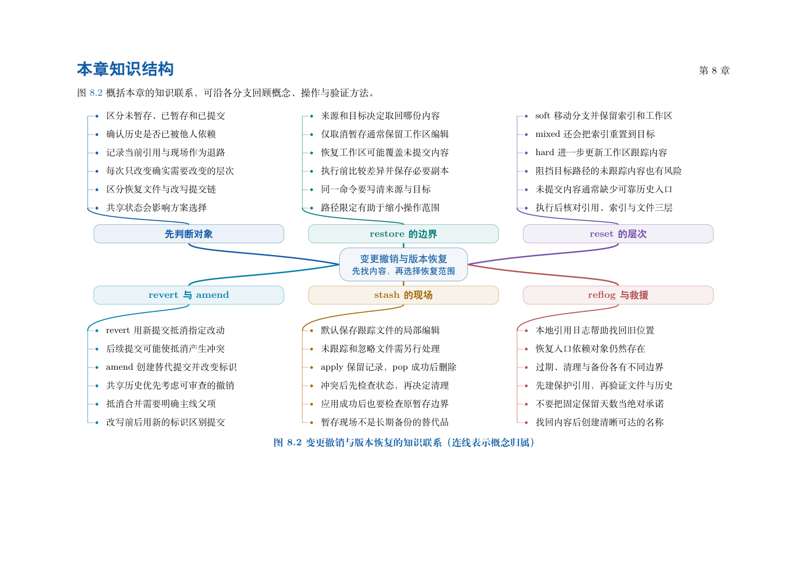

# 第 8 章　变更撤销与版本恢复

“撤销刚才的修改”还不是一个完整需求。希望取回文件、重新组织提交、抵消已经公开的改动，或临时收起未完成工作，所需操作各不相同。若没有说明要保留什么，同一个“撤销”词语可能指向完全不同的结果。

本章以工作区、索引、提交和共享历史为判断依据，先建立恢复目标，再做独立对照实验。对能够找回的提交，先建立保护入口再调整工作位置；对从未保存的编辑，则明确工具能力的边界。

学习目标：根据来源和目标选择 restore；解释三种 reset 模式及路径形式；区分移动入口与追加抵消提交；正确理解合并撤销和 amend 的父关系；保存、应用并处理 stash 冲突；利用本地引用日志建立救援分支。

## 阅读顺序

先阅读教材本章，再研读以下辅导材料；实验运行前预测文件、索引与引用的变化。

- [ch08.md](./ch08.md)

## 本章知识入口

- 恢复之前先回答四个问题
- 实验一：restore 的来源与目标
- 实验二：三个独立副本比较 reset
- 实验三：保留历史并追加纠错
- 实验四：撤销合并以后，再次合并会怎样
- 实验五：amend 替换最近提交的候选版本
- 实验六：stash 保存范围与应用冲突
- 实验七：利用本地日志先建立救援入口
- 共享历史中的恢复决策

## 范例代码

- [extension-08.sh](./examples/extension-08.sh)
- [textbook-route.sh](./examples/textbook-route.sh)

从 GitEasy 根目录运行：

```bash
python3 tools/run_lab.py --chapter 08
```

运行器在临时目录建立教学仓库，不修改当前项目，不连接 GitHub。`textbook-route.sh` 来自书内主实验及其验收断言；`extension-*.sh` 对应独立拓展实验。预期拒绝写在条件分支中，出现拒绝提示不一定表示实验失败。完整输出和最终退出状态由运行器保存。不要把脚本片段直接粘贴到正在工作的仓库中。

## 章末知识结构



## 练习与解析

[练习任务](./exercises.md)要求提交自己的结果与解释；辅导材料中的分析用于核对推理，不替代独立完成。

[返回全书目录](../../README.md)
