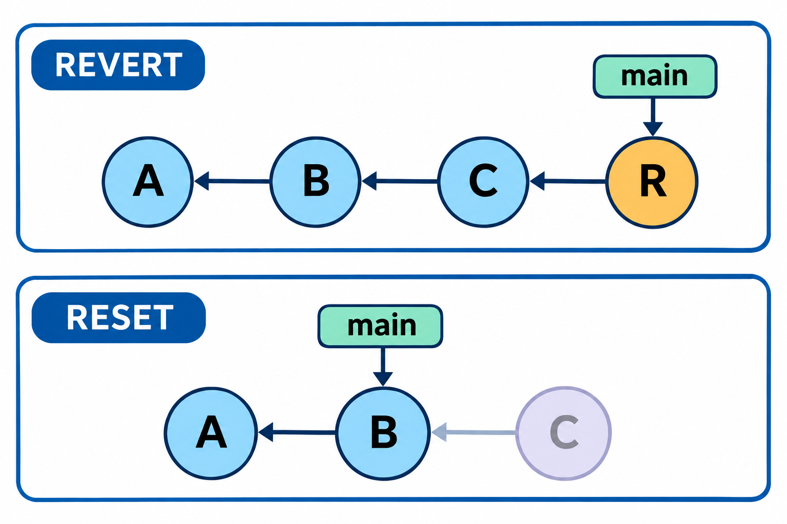
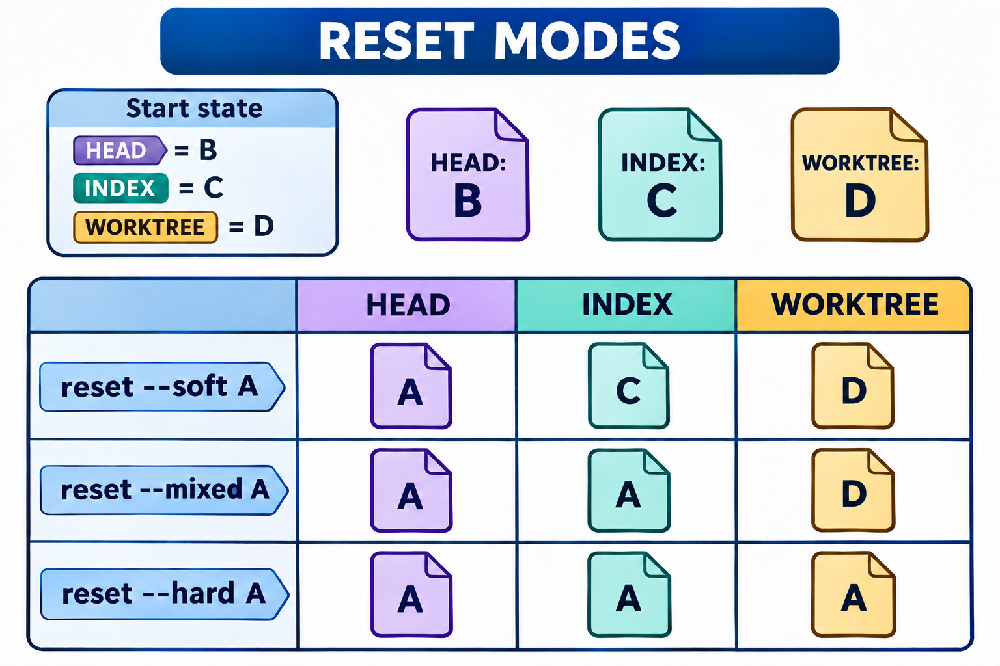

# 变更撤销与版本恢复：图解与复习

这些原创图解配合教材正文使用。提交字母和短标识均为示意；箭头含义见各图说明。

追加纠错与调整历史入口的不同结果。

reset三种模式对提交入口、索引和工作文件的影响。

## 状态与工程情境复习

### 恢复操作的来源与目标

恢复之前应把来源写在一侧，把将要覆盖的目标写在另一侧。显式选择两层时，检查也应覆盖两层，避免用单项diff解释全部结果。

| 选择 | 来源 | 写入目标 |
|---|---|---|
| 恢复工作文件 | 默认索引或指定树 | 工作目录 |
| 取消暂存 | 指定来源，常为HEAD | 索引 |
| 同时指定两层 | 明确选择的树 | 索引与工作目录 |

### hard模式可能影响阻挡目标的路径

hard模式的风险不只涉及目前跟踪的文件。若未跟踪路径阻挡目标版本的写入，也需要事先保全；不要把它与专门清理未跟踪内容的命令混为一谈。

| 路径条件 | 需要注意的结果 |
|---|---|
| 受目标树管理 | 按目标更新文件 |
| 未跟踪且阻挡目标路径 | 可能被移除以完成写入 |
| 其他未跟踪内容 | 不能由此概括全部处理结果 |

### 反向变化与整树恢复的区别

revert围绕指定提交的变化形成反向修改。若后来已有其他工作，应检查反向变化与这些工作的关系，不能把它等同于无条件回到某次旧快照。

| 比较维度 | 追加纠错 | 恢复某棵旧树 |
|---|---|---|
| 保留历史 | 新提交接续已有记录 | 取决于所用操作 |
| 作用内容 | 反向应用指定变化 | 以所选快照内容为目标 |
| 后续工作 | 需要保留并检查 | 可能被目标内容替换 |

### 撤销合并后仍保留祖先事实

撤销合并主要纠正内容，不会抹除原合并的历史连接。再次引入同一主题时，需要同时考虑已有祖先关系与当前内容，而非只重复先前的合并命令。

| 观察对象 | 撤销前后 |
|---|---|
| 合并提交及父链 | 仍是已有历史的一部分 |
| 工作内容 | 按主线父项形成反向修改 |
| 再次合并判断 | 仍依据提交祖先关系 |

### 修订最近提交保留旧新两种身份

amend构造替代提交，名称入口随之更新。旧对象与新对象应分别查询；说明未改变并不表示提交身份未改变，保留旧入口也不代表它仍是当前分支末端。

| 记录 | 树与说明 | 父项 |
|---|---|---|
| 原提交 | 原来选定的内容与字段 | 原有父项 |
| 替代提交 | 修订后的内容或字段 | 通常继续采用原父项 |

### 现场保存范围由选项决定

stash的保存范围不是项目目录的无条件完整副本。保存前先列出需要保护的内容，保存后再核对记录；外部资源与平台资料也应另行安排。

| 内容类别 | 通常默认 | 按选项扩展 |
|---|---|---|
| 已跟踪编辑 | 纳入保存范围 | 具体恢复仍看参数 |
| 未跟踪路径 | 通常不包含 | 可显式要求包含 |
| 忽略路径 | 通常不包含 | 需核对额外选项 |

### 应用冲突时保留记录并核对现场

应用保存的现场可能产生内容冲突。出现冲突时应先检查工作文件和保存列表，再决定后续操作，避免重复应用或过早删除唯一的保存入口。

| 阶段 | 工作现场 | 保存记录 |
|---|---|---|
| 应用之前 | 当前基线及其编辑 | 提供待应用内容 |
| 发生冲突 | 包含需要判断的结果 | 不能假定已删除 |
| 解决之后 | 按任务验证候选 | 确认无遗漏后再整理 |

### 先建立救援入口再继续恢复

日志中的位置序号会随新操作变化，恢复前应核对提交标识和内容。先建立保护入口，可以减少后续查询或切换使目标失去明确名称的风险。

| 步骤 | 目的 |
|---|---|
| 读取本地日志 | 定位可能的旧提交 |
| 查询候选内容 | 确认是否为所需结果 |
| 建立保护名称 | 保留后续访问入口 |
| 继续恢复 | 按目标调整工作现场 |

[可编辑情境图结构源文件](../../assets/git-scenarios.drawio)
