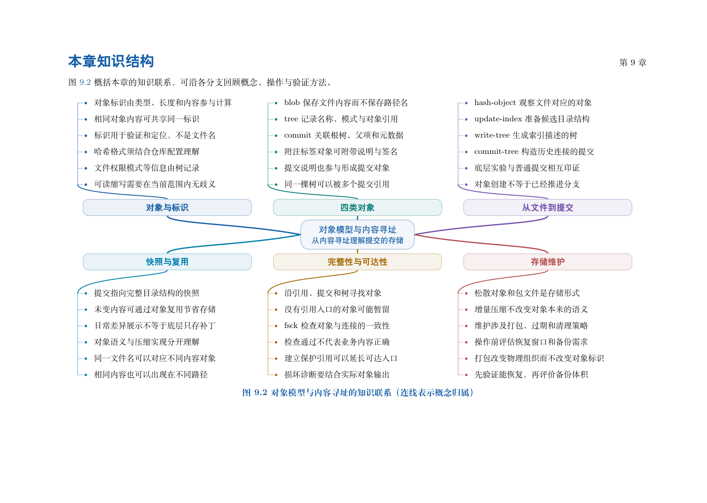

# 第 9 章　对象模型与内容寻址

同一份文件被一百次提交使用，Git 是否必须保存一百份内容？改了文件名，为什么文件内容的标识可能不变？把提交说明改一个字，为什么提交标识就变了？这些问题不能仅靠记住 add 和 commit 的用法回答。本章从“如何保存并重新找到内容”出发，逐层建立 blob、tree、commit 和 tag 的关系，再用实际命令验证。

学习目标：能区分内容、路径和历史各由什么对象记录；能从一个提交定位到文件内容；能解释对象复用与标识变化；能在独立仓库构造提交；能区分逻辑快照、物理压缩、完整性检查和身份信任。

## 阅读顺序

先阅读教材本章，再研读以下辅导材料；实验运行前预测文件、索引与引用的变化。

- [ch09-storage.md](./ch09-storage.md)
- [ch09.md](./ch09.md)

## 本章知识入口

- 从文件名寻址到内容寻址
- 四种对象分别解决什么问题
- 实验一：沿提交查到文件内容
- 同一快照为什么可以有不同提交
- 实验二：用底层命令构造提交
- 对象如何存储：逻辑与物理分层
- 可达性、保留与回收的边界
- 完整性检查不能替代信任判断
- 从模型返回日常操作

## 范例代码

- [extension-09-storage.sh](./examples/extension-09-storage.sh)
- [extension-09.sh](./examples/extension-09.sh)
- [textbook-route.sh](./examples/textbook-route.sh)

从 GitEasy 根目录运行：

```bash
python3 tools/run_lab.py --chapter 09
```

运行器在临时目录建立教学仓库，不修改当前项目，不连接 GitHub。`textbook-route.sh` 来自书内主实验及其验收断言；`extension-*.sh` 对应独立拓展实验。预期拒绝写在条件分支中，出现拒绝提示不一定表示实验失败。完整输出和最终退出状态由运行器保存。不要把脚本片段直接粘贴到正在工作的仓库中。

## 章末知识结构



## 练习与解析

[练习任务](./exercises.md)要求提交自己的结果与解释；辅导材料中的分析用于核对推理，不替代独立完成。

[返回全书目录](../../README.md)
