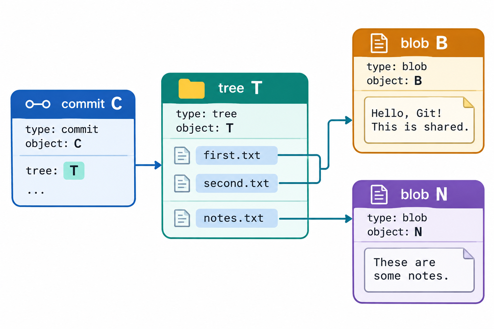
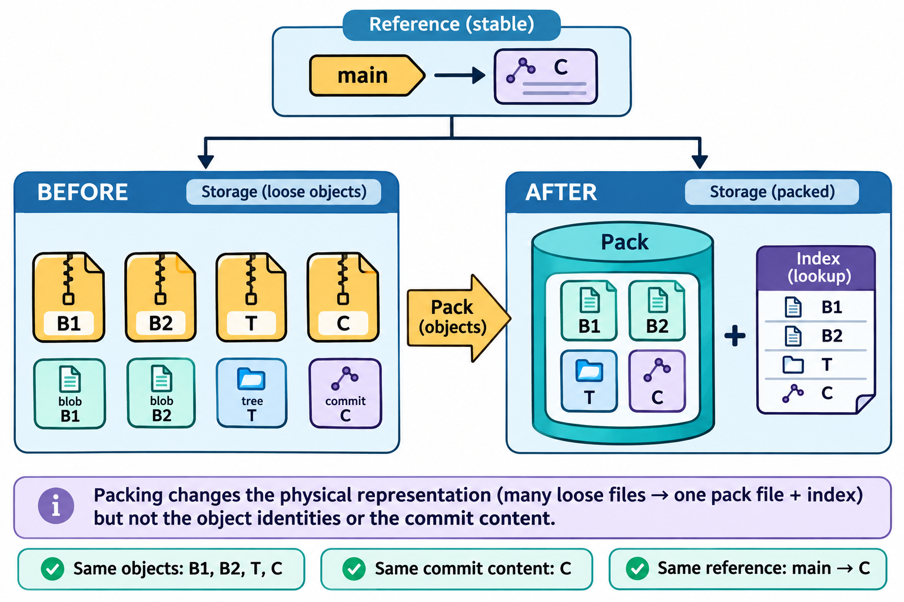

# 对象模型与内容寻址：图解与复习

这些原创图解配合教材正文使用。提交字母和短标识均为示意；箭头含义见各图说明。

提交、树与文件内容对象的连接和复用。

对象打包改变物理表示并保留逻辑身份。

## 状态与工程情境复习

### 对象标识的输入包含类型与长度

计算对象标识时，输入包含类型、长度和精确正文。编辑器显示相近的文本，若编码或换行字节不同，便可能得到不同标识；对象校验应以实际字节为准。

| 组成部分 | 作用 |
|---|---|
| 对象类型 | 区分blob、tree、commit等正文语义 |
| 正文长度 | 按实际字节数描述数据 |
| 分隔与正文 | 以规定格式构成哈希输入 |

### 路径与文件内容分别保存

文件内容相同而路径不同，可以复用同一个blob。路径变化由树条目组织，不能把内容对象的标识当作文件在项目中的永久名称。

| 对象或条目 | 保存的信息 |
|---|---|
| blob | 文件内容，不自带路径名 |
| 树条目 | 名称、模式和目标对象标识 |
| 提交 | 根树、父项及提交元数据 |

### 沿对象连接逐层读取

从提交追到文件，需要逐层读取对象连接。每一步都先检查对象类型，再按相应语义解释正文，避免把任意对象都当作可直接显示的普通文本文件。

| 查询层次 | 下一步依据 |
|---|---|
| 提交正文 | 取得根树标识 |
| 根树及子树 | 按路径取得条目标识 |
| 文件内容对象 | 读取目标文件字节 |

### 同一棵树可以对应不同提交

提交身份由完整对象数据决定，根树只占其中一部分。判断两次提交内容是否相同，应比较树或文件；判断历史记录是否同一对象，则应核对完整提交标识。

| 字段 | 提交甲 | 提交乙 |
|---|---|---|
| 根树 | 相同快照 | 相同快照 |
| 父项或元数据 | 原始取值 | 其中一项改变 |
| 提交标识 | 对象甲的标识 | 通常成为另一标识 |

### 构造对象不等于建立分支入口

底层命令把对象构造的各阶段分开，便于理解日常提交的职责。对象已经写入，并不自动意味着当前分支、索引和工作目录都已相应改变。

| 构造结果 | 已经具备 | 尚需安排 |
|---|---|---|
| 写入blob | 内容对象 | 路径与提交 |
| 形成tree | 快照结构 | 父项与提交信息 |
| 形成commit | 历史记录对象 | 便于访问的引用 |

### 可达性从保留入口沿连接判断

不可达与损坏是不同结论。发现悬空对象时，应先检查内容和保留需要，不能把报告中的存在性线索直接当作应立即删除的依据。

| 情况 | 含义 | 处理依据 |
|---|---|---|
| 从引用可达 | 存在明确历史入口 | 保留并正常查询 |
| 暂不可达 | 当前入口不再指向该对象链 | 结合日志、时间及维护规则判断 |
| 对象损坏 | 数据或连接有异常 | 先保全再诊断 |

### 完整性、身份与内容责任分别验证

对象检查通过可以支持数据完整性的判断，不能替代身份认证或业务验收。发布与交接时，应把这些结论及其证据分别列出。

| 问题 | 适用证据 |
|---|---|
| 数据是否符合对象格式 | 对象校验与连接检查 |
| 是否来自预期主体 | 可信身份及签名材料 |
| 行为是否符合要求 | 审查、构建与测试 |

[可编辑情境图结构源文件](../../assets/git-scenarios.drawio)
