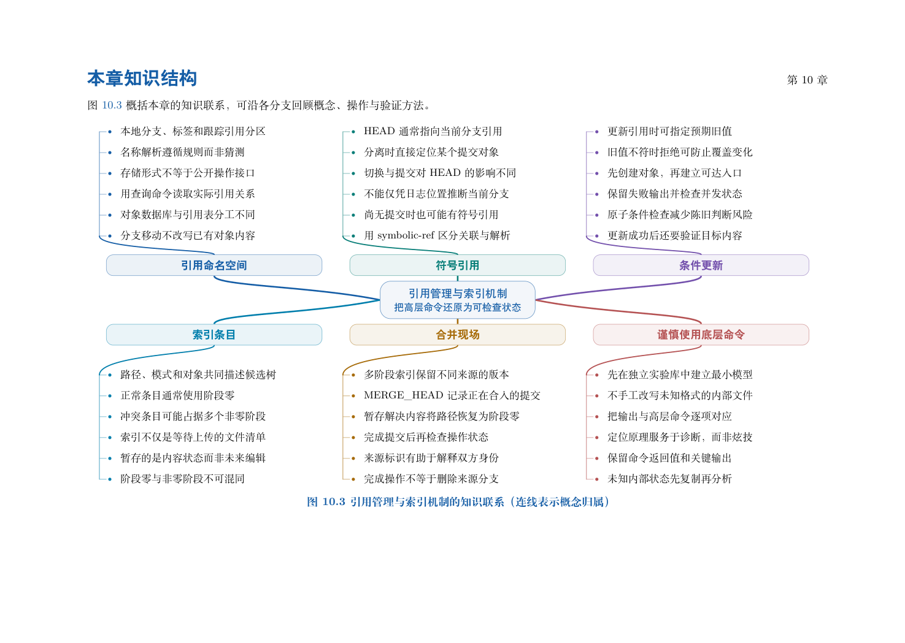

# 第 10 章　引用管理与索引机制

第 9 章解释了快照和历史如何保存为对象。本章转而研究两类会变化的数据：名字当前指向哪里，以及下一次准备提交什么。前者由引用表达，后者由索引组织。对象、引用、索引与工作文件分别承担职责，正是理解“命令成功了，文件为什么没变”这类问题的基础。

学习目标：能够查询全限定引用而不依赖存储文件；区分正常、分离和尚无提交的 HEAD；用带旧值条件的 update-ref 更新练习引用；读懂索引的模式、对象、阶段与路径；从真实冲突中检查三份候选；解释底层构造实验与完整日常命令的边界。

## 阅读顺序

先阅读教材本章，再研读以下辅导材料；实验运行前预测文件、索引与引用的变化。

- [ch10.md](./ch10.md)

## 本章知识入口

- 为什么对象之外还需要名字
- 实验一：名字、HEAD 与条件更新
- HEAD 的三种观察情境
- 名称解析：给人便利，给脚本明确性
- 索引条目：下一次提交如何确定
- 实验二：在冲突中读取三个来源
- 构造双亲提交：内容整合与历史连接分开检查
- 为诊断设计查询顺序

## 范例代码

- [extension-10.sh](./examples/extension-10.sh)
- [textbook-route.sh](./examples/textbook-route.sh)

从 GitEasy 根目录运行：

```bash
python3 tools/run_lab.py --chapter 10
```

运行器在临时目录建立教学仓库，不修改当前项目，不连接 GitHub。`textbook-route.sh` 来自书内主实验及其验收断言；`extension-*.sh` 对应独立拓展实验。预期拒绝写在条件分支中，出现拒绝提示不一定表示实验失败。完整输出和最终退出状态由运行器保存。不要把脚本片段直接粘贴到正在工作的仓库中。

## 章末知识结构



## 练习与解析

[练习任务](./exercises.md)要求提交自己的结果与解释；辅导材料中的分析用于核对推理，不替代独立完成。

[返回全书目录](../../README.md)
