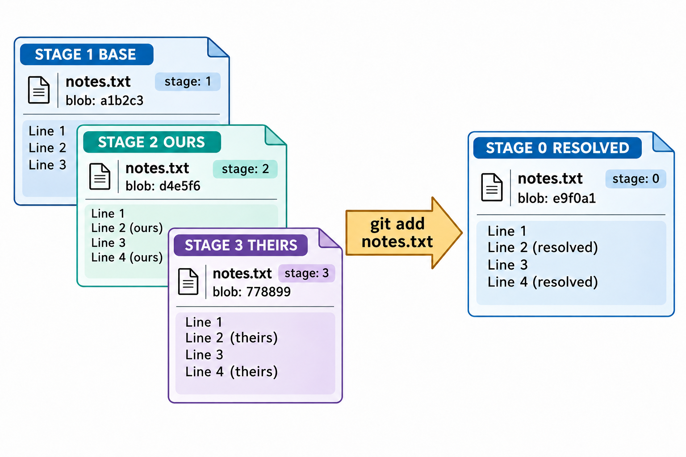
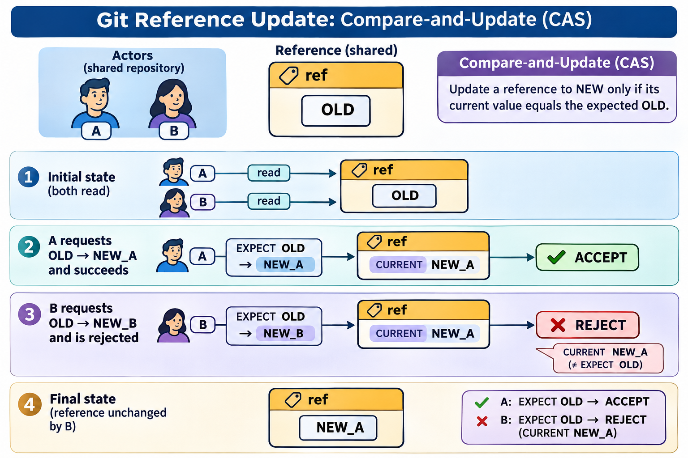

# 引用管理与索引机制：图解与复习

这些原创图解配合教材正文使用。提交字母和短标识均为示意；箭头含义见各图说明。

冲突路径的三个来源及索引阶段。

带预期旧值的引用更新与并发拒绝。

## 状态与工程情境复习

### 脚本先验证名称再读取目标

交互命令中的简写便利不应直接转化为脚本假设。脚本应验证输入、对象类型与失败状态，再执行依赖这些条件的后续动作。

| 阶段 | 要检查的内容 |
|---|---|
| 解释输入 | 名字是否明确且无歧义 |
| 验证目标 | 是否存在并符合所需对象类型 |
| 执行动作 | 参数与路径是否按预期分开 |

[可编辑情境图结构源文件](../../assets/git-scenarios.drawio)
