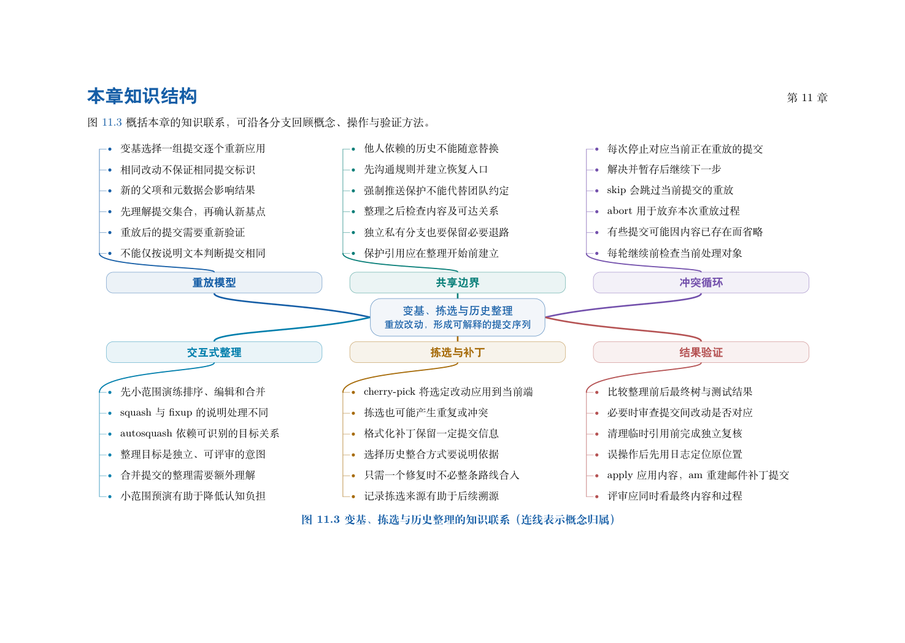

# 第 11 章　变基、拣选与历史整理

提交既是保存点，也是后来阅读项目的线索。开发时形成的记录可能包含补充、修正和试验；交付时则希望每项变化容易理解、验证与移植。本章解释怎样通过重放创建新的历史，怎样检查整理结果，以及为什么共享范围决定操作边界。

学习目标：能从父关系解释变基；能在暂停时判断当前操作并选择继续、中止或跳过；能通过交互式动作组织逻辑提交；能限定拣选与 --onto 的范围；能同时检查树内容和提交关系；能为共享历史迁移制定可协调的方案。

## 阅读顺序

先阅读教材本章，再研读以下辅导材料；实验运行前预测文件、索引与引用的变化。

- [ch11-onto.md](./ch11-onto.md)
- [ch11-patches.md](./ch11-patches.md)
- [ch11-split.md](./ch11-split.md)
- [ch11.md](./ch11.md)

## 本章知识入口

- 重放改变什么，保留什么
- 完整实验一：在新基线上保留主题修改
- 完整实验二：冲突时辨认三方与当前步骤
- 交互式整理：以可理解变化为单位
- 范围移植：--onto 回答三件事
- 拣选：移植一项变化而非接入整条历史
- 比较策略：从团队约束作决定
- 大范围历史清理与协作迁移

## 范例代码

- [extension-11-onto.sh](./examples/extension-11-onto.sh)
- [extension-11-patches.sh](./examples/extension-11-patches.sh)
- [extension-11-split.sh](./examples/extension-11-split.sh)
- [extension-11.sh](./examples/extension-11.sh)
- [textbook-route.sh](./examples/textbook-route.sh)

从 GitEasy 根目录运行：

```bash
python3 tools/run_lab.py --chapter 11
```

运行器在临时目录建立教学仓库，不修改当前项目，不连接 GitHub。`textbook-route.sh` 来自书内主实验及其验收断言；`extension-*.sh` 对应独立拓展实验。预期拒绝写在条件分支中，出现拒绝提示不一定表示实验失败。完整输出和最终退出状态由运行器保存。不要把脚本片段直接粘贴到正在工作的仓库中。

## 章末知识结构



## 练习与解析

[练习任务](./exercises.md)要求提交自己的结果与解释；辅导材料中的分析用于核对推理，不替代独立完成。

[返回全书目录](../../README.md)
