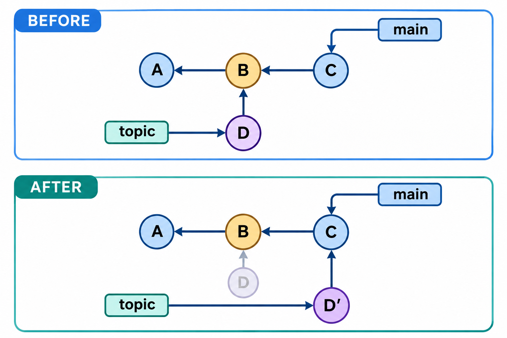
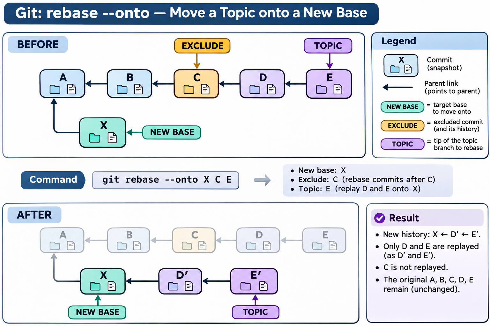

# 变基、拣选与历史整理：图解与复习

这些原创图解配合教材正文使用。提交字母和短标识均为示意；箭头含义见各图说明。

主题变化的重放与新提交身份。

范围变基中的新基线、排除边界与主题末端。

## 状态与工程情境复习

### 变基冲突需要结合当前重放步骤

变基把主题变化应用到新的历史位置，冲突中的相对称谓也应随当前步骤解释。先阅读正在重放的提交和索引来源，再决定采用哪些内容。

| 称谓 | 当前步骤中的含义 |
|---|---|
| 当前侧 | 已经形成的新基线与已重放结果 |
| 重放侧 | 本次待应用提交的变化 |
| 共同来源 | 用于三方处理的原有上下文 |

### 整理动作与提交身份变化

交互式整理服务于可理解的历史。每一步都应保持依赖和候选的完整性，不能只追求提交数量减少或说明形式整齐。

| 动作 | 内容组织目标 | 检查重点 |
|---|---|---|
| 调整次序 | 形成可理解的变化序列 | 依赖是否仍成立 |
| 合并修订 | 把关联变化集中说明 | 说明与实际差异一致 |
| 拆分提交 | 分成可独立理解的修改 | 每个候选是否完整 |

### 拣选带来变化但不接入原父链

拣选把变化放到另一上下文中，目标项目不一定具备来源的全部依赖。应检查差异、构建和测试，不能以来源通过验证作为目标自动正确的依据。

| 观察维度 | 原提交 | 拣选结果 |
|---|---|---|
| 父项 | 来源父链 | 目标当前历史 |
| 变化 | 来源上下文中的差异 | 应用到目标后的结果 |
| 验证 | 来源曾做的检查 | 目标需重新检查依赖 |

### 共享历史整理需要两类约定

历史整理既改变本地记录，也可能影响其他参与者的入口。共享前明确允许整理的范围，操作后交代新旧对应关系，能够减少重复重放与误合入。

| 方面 | 需要确认的内容 |
|---|---|
| 技术目标 | 范围、父链、内容和保护入口 |
| 协作条件 | 其他副本、维护分支与同步方式 |
| 验证材料 | 整理前后差异和测试结果 |

### 清理历史与处置有效凭据分别完成

凭据已泄露时，清理仓库历史不能使凭据自动失效。应先处理实际访问能力，再规划历史清理、缓存与协作副本的迁移。

| 目标 | 首先需要的动作 |
|---|---|
| 停止有效访问 | 撤销或轮换已暴露凭据 |
| 减少历史传播 | 按约定清理所选历史及副本 |
| 恢复协作 | 验证迁移结果并通知授权参与者 |

### 重放前后的保护入口分别保存

整理之前记录原主题末端和新基线，整理之后核对新主题末端。明确三处入口，可以把新旧差异调查与恢复动作分开进行。

| 位置 | 用途 |
|---|---|
| 原主题末端 | 对照旧变化与恢复起点 |
| 新基线 | 明确重放接收位置 |
| 新主题末端 | 查询新父链与验证结果 |

### 范围选择与新位置是不同参数

范围变基的三个角色不能只按命令中的左右次序记忆。先画出保留与排除范围，再写参数，并在重放后检查父链及内容。

| 角色 | 回答的问题 |
|---|---|
| 新基线 | 变化从哪里继续 |
| 排除边界 | 哪些旧历史不再重放 |
| 主题末端 | 从哪个入口确定候选范围 |

[可编辑情境图结构源文件](../../assets/git-scenarios.drawio)
