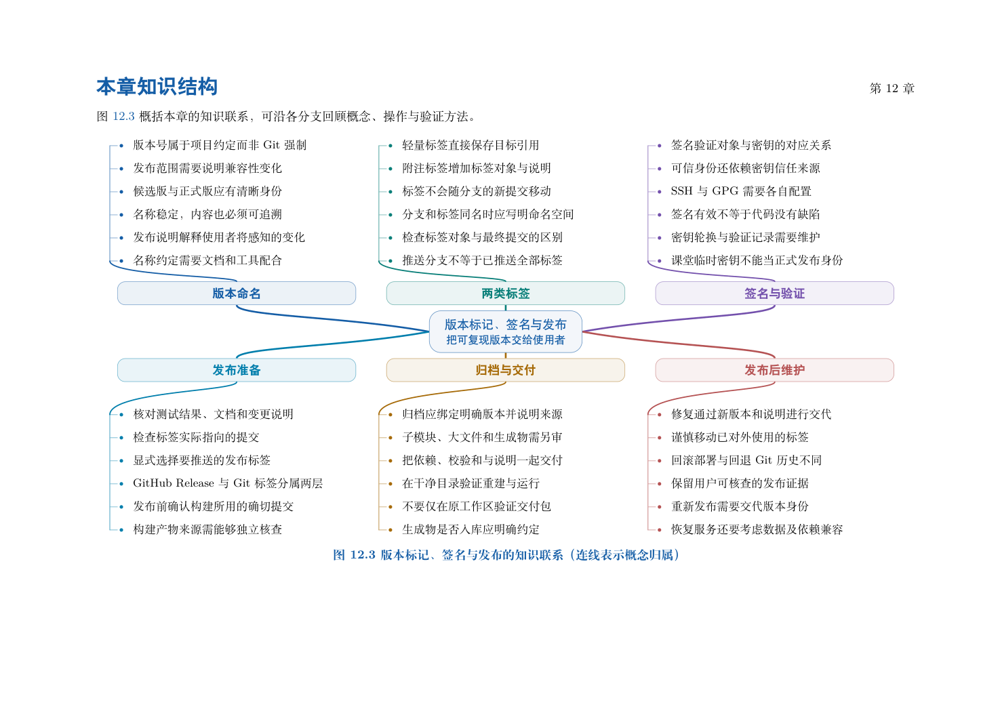

# 第 12 章　版本标记、签名与发布

提交标识能够精确定位历史，却不方便人们谈论“本学期第一版”。标签给重要位置一个约定名称，签名为特定对象提供可验证的密钥证明，发布工程则把源码位置、验证过程和分发资料连接起来。本章依次说明这三层关系。

学习目标：能区分轻量标签与附注标签对象；能显式交换并核对标签目标；能说明版本号的兼容性含义；能区分签名有效、身份可信和内容正确；能为资料或软件项目建立可追溯发布与勘误流程。

## 阅读顺序

先阅读教材本章，再研读以下辅导材料；实验运行前预测文件、索引与引用的变化。

- [ch12.md](./ch12.md)

## 本章知识入口

- 标签命名一个位置，而不是冻结整个项目
- 完整实验：发布位置与主线演进
- 版本号表达约定，不代替兼容性验证
- 签名：从对象完整性到密钥信任
- 从标签走向可追溯发布

## 范例代码

- [extension-12.sh](./examples/extension-12.sh)
- [textbook-route.sh](./examples/textbook-route.sh)

从 GitEasy 根目录运行：

```bash
python3 tools/run_lab.py --chapter 12
```

运行器在临时目录建立教学仓库，不修改当前项目，不连接 GitHub。`textbook-route.sh` 来自书内主实验及其验收断言；`extension-*.sh` 对应独立拓展实验。预期拒绝写在条件分支中，出现拒绝提示不一定表示实验失败。完整输出和最终退出状态由运行器保存。不要把脚本片段直接粘贴到正在工作的仓库中。

## 章末知识结构



## 练习与解析

[练习任务](./exercises.md)要求提交自己的结果与解释；辅导材料中的分析用于核对推理，不替代独立完成。

[返回全书目录](../../README.md)
