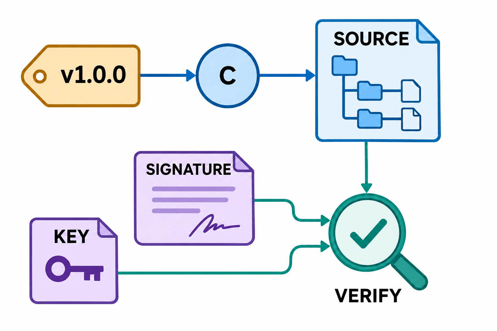
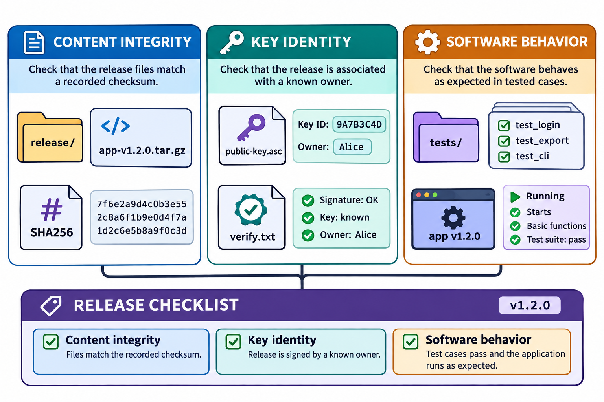

# 版本标记、签名与发布：图解与复习

这些原创图解配合教材正文使用。提交字母和短标识均为示意；箭头含义见各图说明。

版本标记、发布材料与验证记录。

发布验证中相互独立的三类证据。

## 状态与工程情境复习

### 发布入口与开发分支分别演进

标签用于标明交付位置，开发分支用于继续工作。发布以后应同时核对标签目标和产物来源，避免把不断前进的分支名当作固定版本。

| 位置 | 后续开发时的预期 |
|---|---|
| 已发布标签 | 按发布约定保留目标身份 |
| 开发分支 | 随新提交继续前进 |
| 发布说明与产物 | 关联相应标签和验证范围 |

[可编辑情境图结构源文件](../../assets/git-scenarios.drawio)
