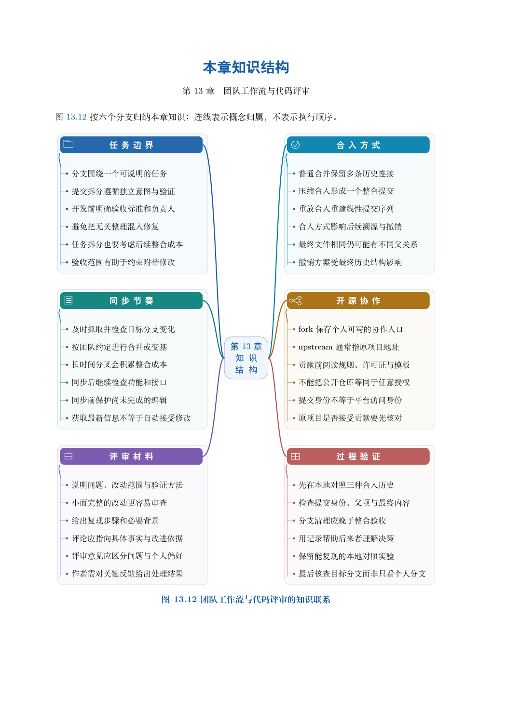

# 第 13 章　团队工作流与代码评审

两个人能够交换提交，还不等于团队已经形成稳定协作。谁能修改主线，什么时候请求评审，怎样决定合入与发布，出错后按什么单位回退，都需要共同约定。本章从一次课程资料改动出发，解释工作流如何连接需求、历史和责任。

学习目标：能按发布与权限需求选择工作流；能区分 fork、分支和 PR；能写出便于验证的变更说明与评审意见；能通过同一实例比较三种合入结果；能识别平台规则的覆盖范围，并形成可交接的协作约定。

## 阅读顺序

先阅读教材本章，再研读以下辅导材料；实验运行前预测文件、索引与引用的变化。

- [ch13-github.md](./ch13-github.md)
- [ch13.md](./ch13.md)

## 本章知识入口

- 工作流中的角色、分支与交付
- 依据项目约束选择工作流
- fork、远端与 PR 是不同层次
- 把需求写成可检验的变化
- 评审关注内容、证据与可维护性
- 完整实验：同一变化的三种合入历史
- 把规则落到可验证的协作约定

## 范例代码

- [extension-13.sh](./examples/extension-13.sh)
- [textbook-route.sh](./examples/textbook-route.sh)

从 GitEasy 根目录运行：

```bash
python3 tools/run_lab.py --chapter 13
```

运行器在临时目录建立教学仓库，不修改当前项目，不连接 GitHub。`textbook-route.sh` 来自书内主实验及其验收断言；`extension-*.sh` 对应独立拓展实验。预期拒绝写在条件分支中，出现拒绝提示不一定表示实验失败。完整输出和最终退出状态由运行器保存。不要把脚本片段直接粘贴到正在工作的仓库中。

## 章末知识结构



## 练习与解析

[练习任务](./exercises.md)要求提交自己的结果与解释；辅导材料中的分析用于核对推理，不替代独立完成。

[返回全书目录](../../README.md)

## 图解与练习升级

本章提供13道分层习题，最后一题为工程综合任务；[图解导读](./visual-guide.md)、[习题](./exercises.md)与[完整题意和解析](./answers.md)相互对应。
