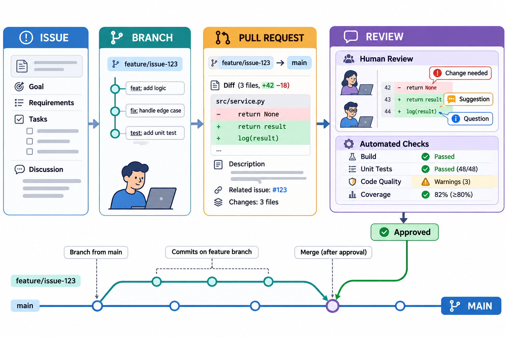

# 团队工作流与代码评审：图解与复习

这些原创图解配合教材正文使用。提交字母和短标识均为示意；箭头含义见各图说明。

需求、主题修改、评审与验证的关联。

**同一分叉起点上的合并、压缩合并与变基**：教材采用可编辑矢量图展示，结构源文件见[图解修订源图](../../assets/git-visual-refinements.drawio)。

## 状态与工程情境复习

### 合入前分别核对三类条件

合入判断不能由单个绿色标记代替。需求、历史结构和过程规则分别回答不同问题，团队应为每一项保留可核对的依据。

| 条件 | 对应证据 |
|---|---|
| 内容满足需求 | 需求、差异与验收结果 |
| 历史符合约定 | base、head和合入方式 |
| 过程规则满足 | 检查、评审与权限记录 |

### 评审意见从现象落实到验证

具体意见应使作者能够复现问题并判断修改方向。处理线程之后仍需核对实际变化，不能将平台状态按钮替代对内容的检查。

| 要素 | 说明内容 |
|---|---|
| 位置与条件 | 在哪个版本及输入下出现 |
| 影响与理由 | 为何影响需求或可维护性 |
| 建议与证据 | 如何修改并验证 |
| 响应与状态 | 采用、讨论或不采用的依据 |

[可编辑情境图结构源文件](../../assets/git-scenarios.drawio)
