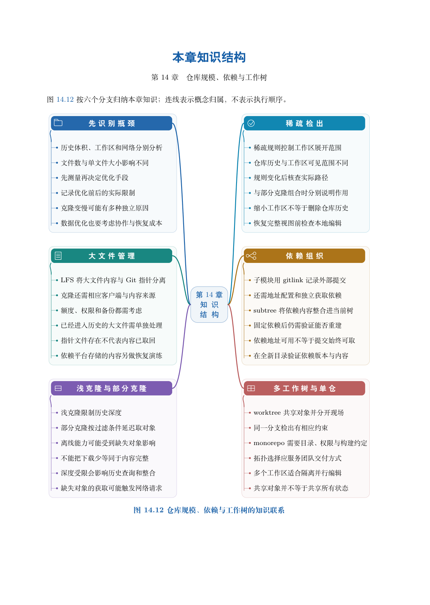

# 第 14 章　仓库规模、依赖与工作树

仓库变大以后，问题并不只有“文件太多”。历史长度影响查询，对象内容影响下载，工作文件数量影响检出与扫描，依赖来源影响复现。本章把这些成本分开，再选择对应机制，避免不经测量就堆叠配置。

学习目标：能区分浅克隆、部分克隆和稀疏检出；能通过实验说明历史、对象与工作区的不同范围；能解释 LFS 的指针与外部内容；能更新并验证子模块固定位置；能比较 subtree 和子模块；能用 worktree 保留开发现场并行维护。

## 阅读顺序

先阅读教材本章，再研读以下辅导材料；实验运行前预测文件、索引与引用的变化。

- [ch14.md](./ch14.md)

## 本章知识入口

- 把规模问题拆成可以测量的成本
- 完整实验一：三种范围的对照
- Git LFS：指针与外部内容分层
- 子模块：在父项目中固定依赖提交
- subtree：把依赖内容纳入普通目录
- worktree：并行目录，共享对象
- 仓库组织与日常配置

## 范例代码

- [extension-14.sh](./examples/extension-14.sh)
- [textbook-route.sh](./examples/textbook-route.sh)

从 GitEasy 根目录运行：

```bash
python3 tools/run_lab.py --chapter 14
```

运行器在临时目录建立教学仓库，不修改当前项目，不连接 GitHub。`textbook-route.sh` 来自书内主实验及其验收断言；`extension-*.sh` 对应独立拓展实验。预期拒绝写在条件分支中，出现拒绝提示不一定表示实验失败。完整输出和最终退出状态由运行器保存。不要把脚本片段直接粘贴到正在工作的仓库中。

## 章末知识结构



## 练习与解析

[练习任务](./exercises.md)要求提交自己的结果与解释；辅导材料中的分析用于核对推理，不替代独立完成。

[返回全书目录](../../README.md)

## 图解与练习升级

本章提供13道分层习题，最后一题为工程综合任务；[图解导读](./visual-guide.md)、[习题](./exercises.md)与[完整题意和解析](./answers.md)相互对应。
