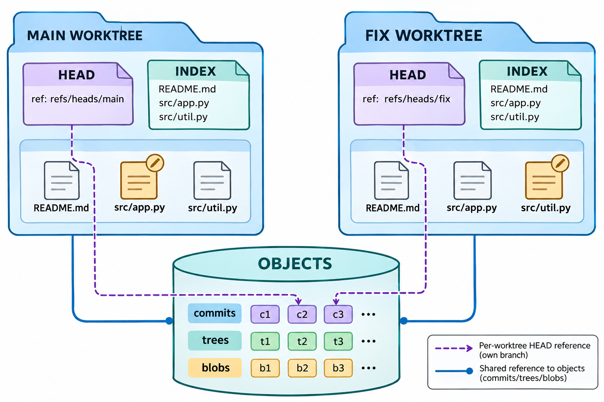
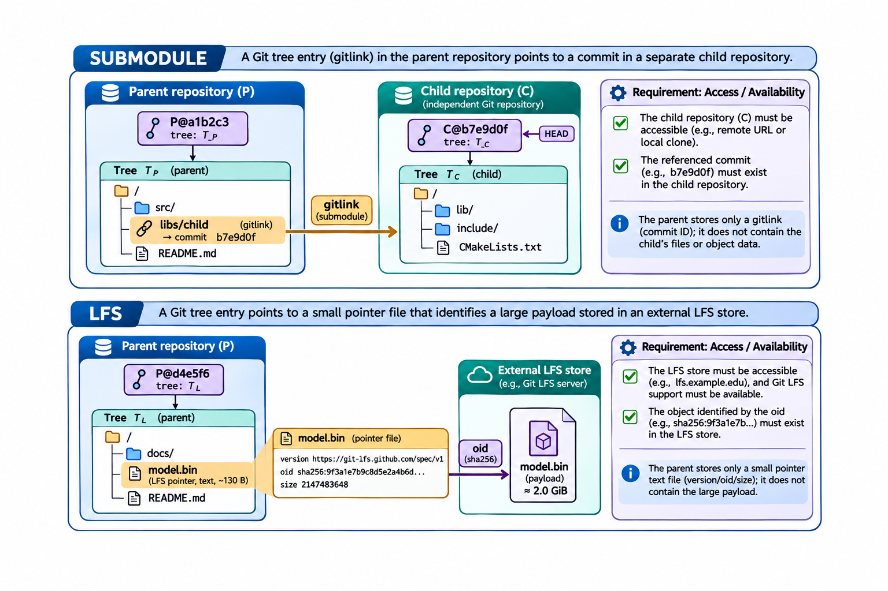

# 仓库规模、依赖与工作树：图解与复习

这些原创图解配合教材正文使用。提交字母和短标识均为示意；箭头含义见各图说明。

共享对象库与独立工作树现场。

子模块提交入口与LFS外部内容指针。

## 状态与工程情境复习

### 三种依赖组织的父仓库记录

依赖组织方案应结合交接与维护任务选择。父仓库实际记录什么，会影响离线取得、独立恢复以及后续更新的操作范围。

| 方式 | 父仓库记录 | 额外取得对象 |
|---|---|---|
| submodule | 子提交入口 | 子仓库历史与检出内容 |
| subtree | 普通目录中的文件 | 后续导入与回送按约定进行 |
| LFS | 小型指针文本 | 外部大文件内容 |

### 规模问题先区分三项成本

工作目录变小、下载变少和历史变短，是三个不同目标。先测量具体成本，再选择浅克隆、部分克隆或稀疏检出，避免用一种优化推断另外两种效果。

| 成本 | 主要观察对象 |
|---|---|
| 取得历史 | 传输的提交与对象范围 |
| 物化文件 | 工作区路径与文件数量 |
| 保存数据 | 对象表示、依赖与外部内容 |

[可编辑情境图结构源文件](../../assets/git-scenarios.drawio)
