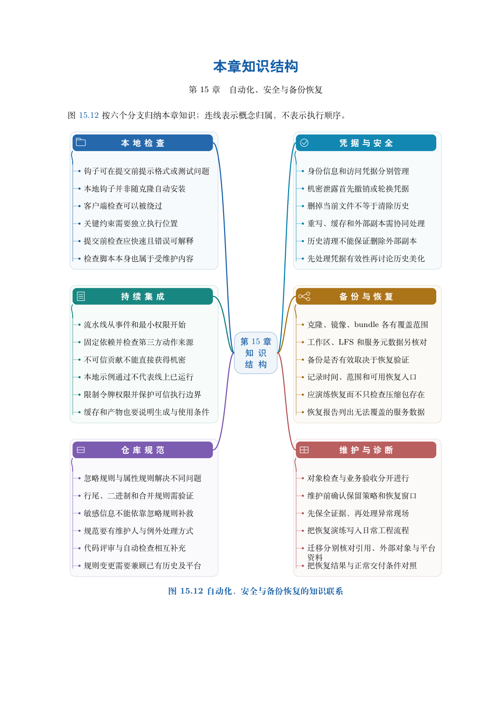

# 第 15 章　自动化、安全与备份恢复

个人可以靠记忆完成一次检查，团队需要把检查对象、触发时机和失败处理写清楚。项目还需要考虑凭据误提交、分支丢失和副本损坏。本章以“先定义要保护什么，再验证机制是否有效”为线索，连接自动检查与恢复演练。

学习目标：能部署并验证索引检查钩子；能区分本地检查、CI 与服务端合入规则；能说明凭据处置的先后关系；能先保存现场再建立救援入口；能验证全量与增量 bundle 的恢复，并列出未被 Git 历史覆盖的数据。

## 阅读顺序

先阅读教材本章，再研读以下辅导材料；实验运行前预测文件、索引与引用的变化。

- [ch15-migration.md](./ch15-migration.md)
- [ch15.md](./ch15.md)

## 本章知识入口

- 自动化首先需要明确输入与判定
- Git 钩子与本地反馈
- 完整实验一：检查候选，验证拒绝与绕过
- CI：明确检出的版本和执行权限
- 凭据误提交：先消除有效访问，再减少传播
- 恢复的第一步是保全现场
- 完整实验二：删除名称以后重建入口
- 完整实验三：全量与增量 bundle
- 备份策略应列出范围与恢复目标

## 范例代码

- [extension-15-migration.sh](./examples/extension-15-migration.sh)
- [extension-15.sh](./examples/extension-15.sh)
- [textbook-route.sh](./examples/textbook-route.sh)

从 GitEasy 根目录运行：

```bash
python3 tools/run_lab.py --chapter 15
```

运行器在临时目录建立教学仓库，不修改当前项目，不连接 GitHub。`textbook-route.sh` 来自书内主实验及其验收断言；`extension-*.sh` 对应独立拓展实验。预期拒绝写在条件分支中，出现拒绝提示不一定表示实验失败。完整输出和最终退出状态由运行器保存。不要把脚本片段直接粘贴到正在工作的仓库中。

## 章末知识结构



## 练习与解析

[练习任务](./exercises.md)要求提交自己的结果与解释；辅导材料中的分析用于核对推理，不替代独立完成。

[返回全书目录](../../README.md)

## 图解与练习升级

本章提供13道分层习题，最后一题为工程综合任务；[图解导读](./visual-guide.md)、[习题](./exercises.md)与[完整题意和解析](./answers.md)相互对应。
