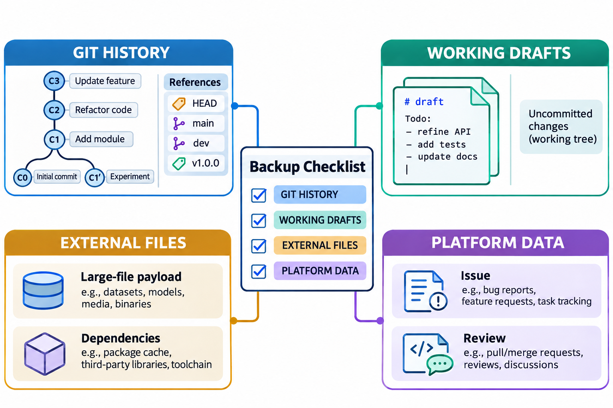
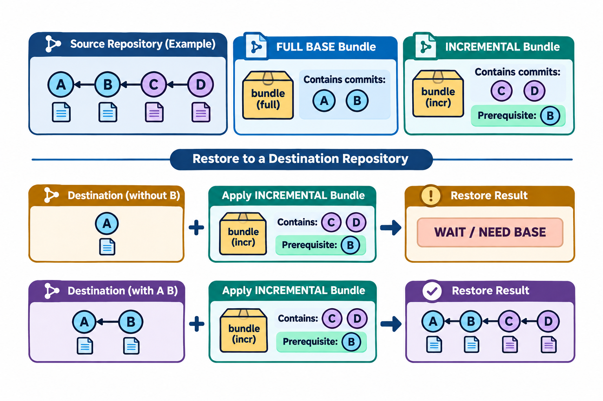

# 自动化、安全与备份恢复：图解与复习

这些原创图解配合教材正文使用。提交字母和短标识均为示意；箭头含义见各图说明。

按恢复目标区分备份范围。

增量bundle的前提与分步恢复。

## 状态与工程情境复习

### 本地反馈与服务端验收分开设置

本地钩子有利于缩短反馈时间，但不能单独充当团队的强制验收机制。服务端检查应针对明确输入重新执行，并保留结果。

| 环节 | 作用 | 限制 |
|---|---|---|
| 本地钩子 | 提前发现候选问题 | 受本地配置与调用方式影响 |
| 独立检查 | 验证指定输入版本 | 覆盖范围由步骤与断言决定 |
| 团队规则 | 约束可接受的合入 | 需结合实际服务端设置 |

### 入口恢复与工作现场恢复分别安排

删除名称后可能仍能找回对象，未提交草稿则需要其他保存来源。恢复方案应说明每类资料的来源，避免把一种成功推广为全部现场均已恢复。

| 目标 | 先核对 | 再执行 |
|---|---|---|
| 找回提交 | 日志与对象内容 | 建立救援入口 |
| 找回未提交稿 | 其他保存位置与备份 | 独立还原并比较 |
| 重新交接 | 历史、文件和外部范围 | 在新位置验证恢复 |

[可编辑情境图结构源文件](../../assets/git-scenarios.drawio)
