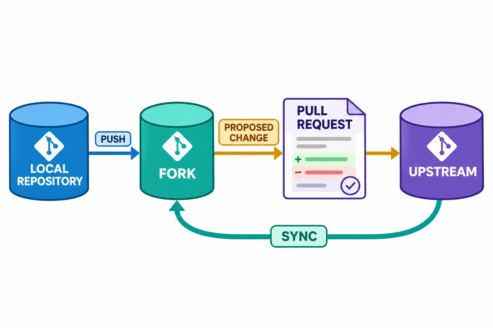

# GitHub平台与图形化工具：图解与复习

这些原创图解配合教材正文使用。提交字母和短标识均为示意；箭头含义见各图说明。

个人副本、本地修改与平台贡献过程。

**提交前进后检查证据的版本对应关系**：教材采用可编辑矢量图展示，结构源文件见[图解修订源图](../../assets/git-visual-refinements.drawio)。

## 状态与工程情境复习

### 从问题描述到可验收任务

Issue需要把现象写成可重复验证的条件。示例聚焦挂失后的新请求；已完成请求的合法重试由幂等规则另行判断，不能混作同一失败路径。

| 要素 | 校园项目中的示意 |
|---|---|
| 触发条件 | 卡片已挂失后发起新的消费请求 |
| 预期结果 | 拒绝请求且余额与流水不变 |
| 验证方法 | 检查异常类型与两项不变量 |
| 完成依据 | 代码差异、测试和关联PR |

### 图形操作仍应回到三份内容核对

客户端可以同时呈现多个观察位置。遇到不熟悉的按钮时，先确认它对应的状态与组合动作，再用Git查询核对结果，避免仅根据界面颜色作出判断。

| 界面观察 | 命令行对应的问题 |
|---|---|
| 文件状态区 | 哪些路径存在候选或工作编辑 |
| 差异预览 | 当前实际比较哪两份内容 |
| 提交历史图 | 名称指向与父关系如何连接 |
| 同步提示 | 取得、整合与推送分别发生了什么 |

[可编辑情境图结构源文件](../../assets/git-scenarios.drawio)
