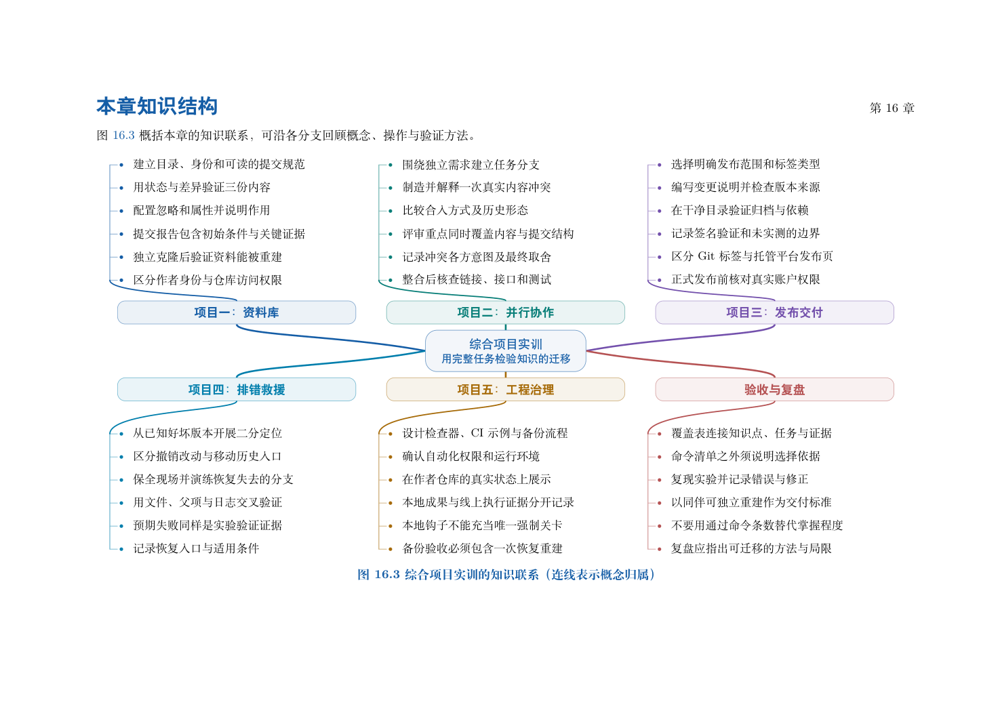

# 第 16 章　综合项目实训

前面各章分别解释了 Git 的对象、操作和工程约束。实际项目不会按章节顺序出题：同一项需求可能同时涉及修改范围、分支、远端、评审和发布。本章以 GitEasy 为共同载体，设置五个递进项目，把分散的知识组织成可以交接的成果。

学习目标：能根据需求拆分任务与提交；能在协作中保留双方成果并解释冲突决定；能整理尚未共享的历史并发布可追溯版本；能明确依赖、检查与备份的覆盖；能提交包含内容、过程和解释的完整项目报告。

## 阅读顺序

先阅读教材本章，再研读以下辅导材料；实验运行前预测文件、索引与引用的变化。

- [ch16.md](./ch16.md)

## 本章知识入口

- 共同载体、角色与成果约定
- 项目一：把课程资料变成可检索的历史
- 项目二：两人共同修订同一门课程
- 项目三：整理历史并发布可追溯版本
- 项目四：依赖、并行维护与安全恢复
- 项目五：GitHub 上的完整交付
- 知识点到项目任务的覆盖检查
- 评分与案例解析

## 范例代码

- [textbook-route.sh](./examples/textbook-route.sh)

从 GitEasy 根目录运行：

```bash
python3 tools/run_lab.py --chapter 16
```

运行器在临时目录建立教学仓库，不修改当前项目，不连接 GitHub。`textbook-route.sh` 来自书内主实验及其验收断言；`extension-*.sh` 对应独立拓展实验。预期拒绝写在条件分支中，出现拒绝提示不一定表示实验失败。完整输出和最终退出状态由运行器保存。不要把脚本片段直接粘贴到正在工作的仓库中。

## 章末知识结构



## 练习与解析

[练习任务](./exercises.md)要求提交自己的结果与解释；辅导材料中的分析用于核对推理，不替代独立完成。

[返回全书目录](../../README.md)
