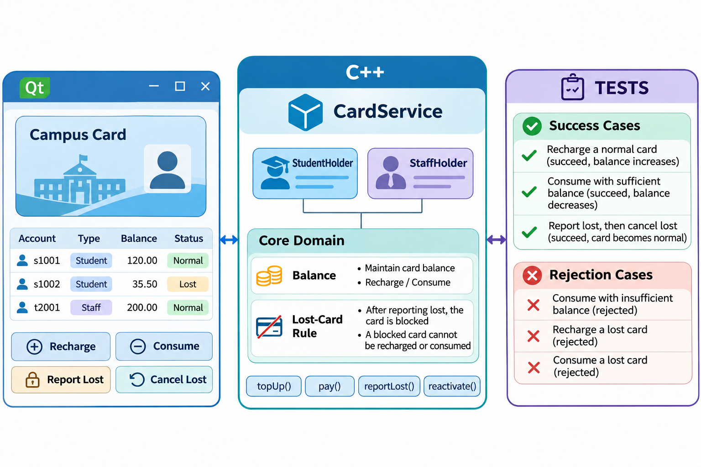
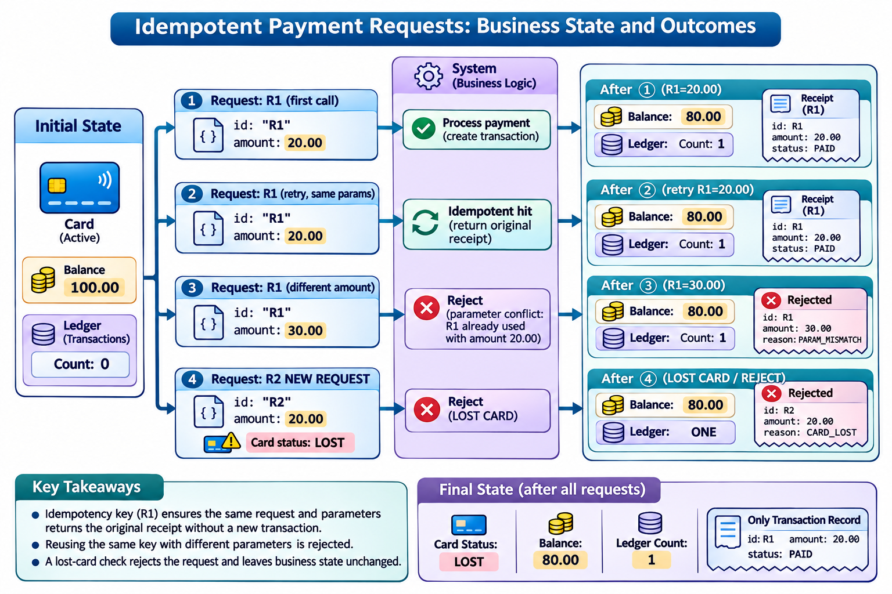

# 校园一卡通系统版本管理实训：图解与复习

这些原创图解配合教材正文使用。提交字母和短标识均为示意；箭头含义见各图说明。

校园一卡通的领域对象、服务与界面分层。

请求幂等、参数冲突与挂失拒绝的状态约束。

图中Ledger从余额100.00的观察起点开始，仅统计这一组请求新增的消费记录；工程完整流水仍保留此前的充值记录。合法的既有请求重试返回原回执，挂失后发起的新请求R2被拒绝。

## 状态与工程情境复习

### 需求、实现和验证形成对应

项目任务应沿需求、实现和验证建立对应关系。围绕同一条规则安排分支与提交，使评审者能够定位实现位置，并判断测试是否覆盖了验收条件。

| 需求 | 实现位置 | 验证对象 |
|---|---|---|
| 挂失拒绝新消费 | 服务与卡片状态 | 余额及流水不变 |
| 请求幂等 | 请求记录 | 合法重试不重复扣款 |
| 限额策略 | 持卡人策略 | 边界与拒绝路径 |
| 流水交付 | 导出接口 | 字段、顺序与金额 |

### 多态用于选择不同持卡人策略

不同持卡人类别可以通过统一接口提供策略，业务服务按接口使用结果。测试应同时覆盖各具体实现和服务的边界行为，不能只验证类型能够构造。

| 调用者 | 统一接口 | 不同实现 |
|---|---|---|
| 业务服务 | 消费限额等策略查询 | 学生策略 |
| 业务服务 | 同一抽象接口 | 教职工策略 |

### 金额以最小货币单位参与计算

业务核心使用最小货币单位保存金额，界面负责格式化显示。图示以100.00元余额和20.00元消费说明计算与显示的对应，重试不再次改变余额。

| 示意步骤 | 金额／分 |
|---|---|
| 初始余额 | 10000 |
| 消费20.00元 | 扣除2000 |
| 成功后余额 | 8000 |
| 相同请求重试 | 仍为8000 |

### 挂失与解挂只在明确状态间转换

状态变化和消费处理应分别验证。挂失后的新请求需要被拒绝；恢复卡片状态后，消费仍受余额、限额与请求规则约束，不能跳过其他检查。

| 原状态 | 操作 | 结果 |
|---|---|---|
| 正常 | 挂失 | 进入挂失状态 |
| 挂失 | 新消费请求 | 拒绝且保留业务数据 |
| 挂失 | 按规则解挂 | 恢复正常状态 |

### 构建目标保持业务与界面分层

核心与界面分层使不同环境能够验证相应目标。基础业务测试不应依赖窗口是否成功显示，界面检查则补充按钮、输入与结果展示的交互证据。

| 目标 | 依赖重点 | 验证目的 |
|---|---|---|
| 业务核心 | C++11领域与服务 | 规则可独立测试 |
| 命令行与测试 | 业务核心 | 无需界面即可回归 |
| Qt界面 | 业务核心与Qt6 | 交互目标按C++17构建 |

### 界面交互与业务状态对应验证

界面测试需要比较操作前后的可观察结果，并核对其对应的业务状态。只截取一张窗口图片，不能说明全部按钮和拒绝路径已经验证。

| 操作 | 观察位置 | 拒绝时核对 |
|---|---|---|
| 充值与消费 | 余额及流水显示 | 保留先前业务状态 |
| 挂失与解挂 | 卡片状态显示 | 提示与实际状态一致 |
| 导出流水 | 输出文件内容 | 路径与错误提示清楚 |

### 并行开发先约定接口与验收

双人开发需要划分可以独立说明的任务，同时保留共同接口与验收约定。两条分支分别通过检查后，还要验证组合结果，才能完成整合。

| 角色 | 独立修改 | 共同约定 |
|---|---|---|
| 开发者甲 | 主题一与相应测试 | 接口及数据格式 |
| 开发者乙 | 主题二与相应测试 | 业务不变量 |
| 整合者 | 审查与整合结果 | 分支及发布规则 |

### 候选检查与工作目录检查分开

部分暂存可能使磁盘文件与候选不同。综合实训应分别验证实际检查的输入，并在独立目录重新构建提交，防止把工作现场的成功误作候选完整的证明。

| 检查输入 | 能够支持的结论 |
|---|---|
| 工作目录 | 当前磁盘内容通过指定检查 |
| 索引构造的候选 | 准备提交的内容通过指定检查 |
| 独立检出的提交 | 记录下来的版本可被重新构建 |

### 真实PR对应明确的方向与版本

迁移到GitHub后，本地的提交与引用模型仍然成立。平台记录补充请求方向、讨论和检查依据；展示时应标明真实记录，教学模板不填入虚构批准。

| 要素 | 需要保存的信息 |
|---|---|
| base | 接收仓库与目标分支 |
| head | 贡献仓库与主题分支 |
| 版本 | 提出变化时的提交身份 |
| 证据 | 适用的检查与人工评审 |

### 维护修复需要重新验证目标上下文

主线修复移植到维护分支后，目标的依赖与接口可能不同。维护发布需要在该分支重新构建和测试，不能沿用主线结论覆盖目标版本。

| 阶段 | 关键判断 |
|---|---|
| 定位问题 | 判定稳定且版本边界明确 |
| 形成修复 | 范围集中且原因可解释 |
| 移植维护线 | 依赖与接口满足目标版本 |
| 再次发布 | 标签、产物及测试对应 |

### 源码交付与历史交付分别验收

交付资料应与接收者的任务对应。只需要运行某一版本与需要继续维护历史，是不同恢复目标；完成交接前应在独立位置逐项验收。

| 材料 | 包含的主要范围 | 独立验收 |
|---|---|---|
| 源码归档 | 所选版本文件 | 解包、构建与运行 |
| 历史包 | 选定Git历史及其前提 | 校验、导入与查询 |
| 交接清单 | 外部资料和平台记录 | 逐项确认取得条件 |

### 独立克隆分别构建和核对

两个工作现场应各自执行构建与测试。独立克隆获得Git数据，但本地构建目录、身份配置和未提交文件不随另一现场的操作自动同步。

| 仓库位置 | 已有数据 | 需要独立验证 |
|---|---|---|
| 协作中心 | 共享Git历史 | 提供约定的读写入口 |
| 工作现场甲 | 克隆与本地配置 | 构建并运行测试 |
| 工作现场乙 | 另一个独立克隆 | 重新构建并核对状态 |

### 竞争推送以后先取得服务器进展

推送竞争使两个独立现场的历史差异变得可见。处理时先取得服务器进展，再按约定整合，不能以强制覆盖省略对同伴成果的核对。

| 阶段 | 本地需要完成的判断 |
|---|---|
| 推送被拒绝 | 读取原因并保留自己的提交 |
| 抓取最新状态 | 核对来源入口与祖先关系 |
| 整合并验证 | 同时保留两项已验收修改 |
| 再次推送 | 确认服务器目标确已更新 |

### 冲突解决保持双方有效需求

内容分歧需要回到需求解释。双方意图都应在解决决定中得到回应；最终候选必须能够说明保留、调整或放弃各项内容的理由。

| 来源 | 提交的意图 | 最终验收 |
|---|---|---|
| 甲的修改 | 表达一项资料修订 | 相应需求继续满足 |
| 乙的修改 | 表达另一项修订 | 相应需求继续满足 |
| 共同结果 | 按约定形成一致内容 | 差异与测试共同核对 |

### 发布基线为回归调查提供入口

回归修复需要保留发布起点、失败版本和修复结果。把能够稳定暴露问题的测试与修复放在同一条可追查链上，有助于以后定位和维护。

| 位置 | 用途 |
|---|---|
| 课程发布标签 | 固定已交付的起点 |
| 出现问题的版本 | 提供可重复的失败条件 |
| 修复提交 | 集中说明原因与修正 |
| 回归测试 | 防止相同条件再次失败 |

### 未共享提交按完整意图整理

尚未共享的提交便于按完整意图整理，但仍需保存起点和验证结果。整理后重新阅读差异与父链，确认补充内容没有遗漏，也没有混入无关修改。

| 整理前 | 整理动作 | 整理后核对 |
|---|---|---|
| 实现与后续补充 | 说明关联的fixup关系 | 变化是否合成完整提交 |
| 已有主题序列 | 在规定范围内重放 | 父链与提交说明 |
| 本地试验结果 | 完成独立测试 | 再决定何时共享 |

### 回归定位区分业务判定与运行异常

自动二分要求判定脚本稳定且含义明确。业务失败与运行异常应使用不同结果处理，定位完成后还要阅读候选差异，说明证据支持的因果范围。

| 结果 | 在判定脚本中的意义 |
|---|---|
| 规则满足 | 可以标记为好 |
| 同一规则不满足 | 可以标记为坏 |
| 环境或构建异常 | 按协议报告或跳过 |
| 定位结束 | 恢复入口并记录证据 |

[可编辑情境图结构源文件](../../assets/git-scenarios.drawio)
