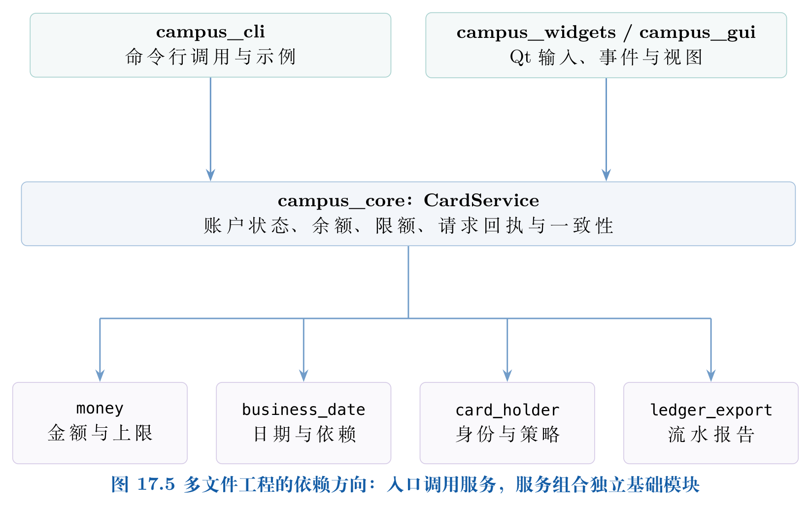

# CampusCard · 校园一卡通版本管理实训

本项目是张庆科编著《Git版本控制原理与实践》第17章的多文件工程案例。开发先依据[企业项目实施方案](docs/enterprise-project-plan.md)，再进行[任务拆分与迭代](docs/iterations.md)，按需求、接口、分支、测试、评审、发布与恢复组织工作。场景为高校软件团队开发校园服务台应用：学生卡与教工卡开卡、充值、消费、挂失、解挂和流水导出。所有身份均为合成数据。

业务核心采用**C++11**，Qt 6 Widgets界面目标采用Qt要求的**C++17**。两者独立构建，先通过核心测试再加入界面，Git的开发、评审、修复、发布与交接贯穿两条构建路径。

## 从规划进入实现

工程按金额、日期、持卡人、流水报告、业务服务、CLI与Qt拆分文件；头文件表达接口，实现文件保存职责，CMake组织独立目标。核心测试分为金额、日历、导出、日期依赖和服务集成；启用Qt后增加实际按钮检查。源码注释说明单位、所有权、约束和失败后的状态。



## 五分钟运行核心

需要CMake 3.16及以上版本和支持C++11的编译器：

```bash
cmake -S . -B build -DCMAKE_BUILD_TYPE=Release
cmake --build build --parallel 2
ctest --test-dir build --output-on-failure
./build/campus_cli
```

Windows多配置生成器使用 `cmake --build build --config Release` 与 `ctest --test-dir build -C Release`，程序通常位于 `build/Release`。

## Qt图形界面

另行安装Qt 6 Widgets开发组件与支持C++17的编译器。若CMake不能定位Qt，使用安装器给出的Qt前缀路径设置 `CMAKE_PREFIX_PATH`：

```bash
cmake -S . -B build-qt -DCAMPUS_BUILD_GUI=ON
cmake --build build-qt --parallel 2
ctest --test-dir build-qt --output-on-failure
./build-qt/campus_gui
```

界面依次执行开卡、充值与消费；选择账户行可填写卡号。挂失后的充值或消费会被拒绝，解挂恢复可用状态。流水导出是本次运行的CSV报告，**不是数据库备份**。退出应用后内存状态不会持久保存。

## 工程边界与教学重点

这是单进程教学原型，未接入真实支付、学生隐私系统或生产数据库，不承担真实资金业务。金额以整数分表示；业务层验证余额、单日限额、挂失状态与请求幂等性。请求标识连同卡号、业务、金额和日期共同决定能否复用原回执。

- [需求与验收](docs/requirements.md)：任务拆分及验收证据。
- [架构与C++11要点](docs/architecture.md)：封装、继承、多态、RAII与lambda。
- [团队协作手册](docs/team-workflow.md)：分支、PR、评审、发布与维护。
- [45项Git技能工作包](docs/git-skill-matrix.md)：连续演练、专项实验和人工平台任务。
- [架构决策](docs/decisions.md)：记录边界、选择与影响。
- [交付验收](docs/acceptance.md)：业务、模块、协作与发布证据。
- [交接报告模板](docs/handover-template.md)：重建、依赖与恢复记录。

从GitEasy根目录运行 `python3 tools/run_enterprise_lab.py` 可完成隔离的双人演练。该演练使用本地裸仓库模拟服务器；真实GitHub Issues、PR与权限验收按教材另行执行并记录，不能用本地模拟冒充线上评审。
